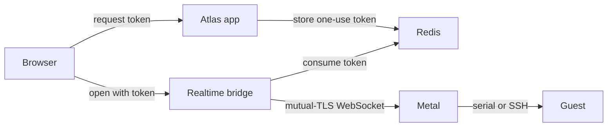

# Open a VM console

A console lets a person interact with a VM when normal network access is unavailable or inconvenient. Atlas checks access to the VM. Metal connects to the guest. The browser never connects to Metal or receives its client certificate.

## Follow the connection

In Desk, the VM form opens `/vm_console` with a token in the URL fragment. The fragment stays in the browser and is not sent with the page request. API callers can request a token with `POST /api/atlas/virtual-machines/{id}/actions/console-token`. The [Atlas API reference](/api/atlas/) gives the fields.

The browser uses Socket.IO to send the token to the Atlas realtime bridge. It starts with HTTP polling and can upgrade to WebSocket. The reverse proxy must preserve the browser host and route the request to the correct Frappe site. The bridge takes it from Redis in one operation, then opens a mutual-TLS WebSocket to the VM's Metal host.

The token is valid for **30 seconds** and works **once**. A reload cannot reuse it. Open a new console from the VM form, or request another token through the API. If Metal cannot be reached after the token is used, a new token is also needed.

## Configure the realtime proxy

Frappe Desk and the console start with HTTP polling and can upgrade to WebSocket. Same-origin polling GET requests can omit the `Origin` header. Frappe realtime authentication compares the origin hostname with `Host`, so a proxy that forwards an absent origin can cause `Invalid origin`.

The [Atlas VM installer](../../scripts/atlas-vm/setup.py) calls `pilot setup production`, which generates the proxy configuration from Pilot's `pilot/managers/nginx/templates/bench.conf.template`. That template owns the missing-origin fallback. Deploy Pilot with the [alias Origin fix](https://github.com/kodykebab/pilot/commit/63b8e120) when using non-redirecting site aliases. Do not edit generated nginx files or force WebSocket transport in Frappe's client.

The generated proxy supplies an origin when it is absent or empty and preserves explicit origins so Frappe can reject requests from other hosts. Site routes use configured public-scheme metadata when an edge terminates TLS. Aliases use the local request scheme. Both preserve the public hostname and set `X-Frappe-Site-Name` to the internal site name. Run `pilot setup nginx` to regenerate this configuration for an existing bench.

Validate polling without an origin, WebSocket upgrade, polling heartbeats, and rejection of foreign origins. Then verify Desk events and console input/output in the browser.

## Choose a mode

| Mode | What you get | When it helps |
| --- | --- | --- |
| TTY, the default | The VM's shared serial console. Recent output replays when you attach. Several viewers can watch. | Inspect boot output or use the guest's serial login. |
| SSH | One new interactive session as `root`. It ends when this browser connection closes or the shell exits. | Get a normal shell in a running guest that supports Atlas SSH access. |

TTY output is collected while the VM runs, even with no viewer. A slow viewer is disconnected so it cannot block the guest.

The browser encodes terminal input as UTF-8 before transport. This preserves non-ASCII text in typed input and pasted commands.

A TTY session stays open when the VM stops or restarts. It shows the output of the next boot. Metal discards input that you type while the VM is stopped.

A `metald` restart closes the WebSocket with code `1012`. Atlas reconnects to the same console for up to 60 seconds. Both modes keep the guest shell, but input sent during the restart is lost.

The SSH client runs in a separate systemd unit, and systemd keeps its console open during the restart. The session ends when the viewer leaves, the shell exits, or no viewer reconnects within 2 minutes.

SSH needs a reachable guest and its SSH service. Metal creates a temporary key for that session, adds it through the guest metadata service, and removes it when the session ends. [SSH key changes](ssh-keys.md) explains the guest's key lookup.

::: warning The console is access to the guest
The VM write permission allows a user to request a console token. Read permission alone does not allow console access. Both TTY and SSH consoles can modify the guest, so they require the same permission as VM administration. A console token is a bearer credential until the bridge consumes it.
:::

## If the console does not open

Check that the VM is running, the token is new, and the assigned Metal host is reachable. For SSH mode, check that the guest image supports Atlas SSH keys and that its SSH service is running.

A TTY session can show boot errors when SSH is not ready. [Find a problem](../operate/find-a-problem.md) gives the next host checks.

::: details Source code and tests

- [VM permission check](../../atlas/vm/doctype/virtual_machine/virtual_machine.py) and [token store](../../atlas/vm/core/console_token.py) issue console access.
- [Desk console action](../../atlas/vm/doctype/virtual_machine/virtual_machine.js) and [browser terminal](https://github.com/frappe/atlas/blob/develop/atlas/www/vm_console.html) open the session.
- The realtime bridges for [Node](../../realtime/handlers.js) and [Python](../../atlas/realtime/handlers.py) consume the token and forward terminal data.
- [Metal console endpoint](../../metal/internal/api/vm_console.go), [serial mode](../../metal/internal/api/vm_console_tty.go), and [SSH mode](../../metal/internal/api/vm_console_ssh.go) join the guest.
- [SSH runtime](../../metal/internal/firecracker/ssh.go) owns the temporary key and session cleanup.
- Run `node realtime/test_console.cjs` from the repository root to check text encoding and disconnect handling. CI runs this check with the rescue dialog tests.

:::
