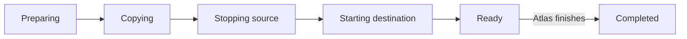

# How does the Metal migration engine recover?

Destination Metal drives transfer. Atlas owns regional assignment. Use the [migration scenario tables](migration.md#what-happens-in-each-migration-scenario) for operator outcomes, fallback decisions, timers, and error codes.

## Which checkpoints does Metal save?

Metal stores migration records beside each VM's records. The destination reserves the VM ID first. It reserves capacity after it receives the source definition. The source lock blocks normal VM changes.

Normal get and list operations hide the incoming destination VM until its reservation ends, including while it reports `ready`.



The diagram shows public phases. Durable records divide these phases into smaller checkpoints.

| Destination checkpoint | Saved work and next action |
| --- | --- |
| `preparing` | Save the request. Lock the source, read its definition, check capacity, and reconstruct destination records. |
| `copying` | Save each interval and its completion. Request the next sequence after the last completed sequence. |
| `stopping` | Stop the source and receive final disk and memory snapshots. Save each transfer's completion separately. |
| `creating_network` | Create and record the destination network. |
| `applying_state` | Apply disk-only state or load memory paused. Record a fallback cause only after runtime cleanup and network recreation succeed. |
| `ready` | Wait for the Atlas finish or abort request. |
| `finishing` | Activate the destination, destroy the source, then remove received snapshots and memory staging. |
| `removing_runtime` | Remove destination runtime and network. |
| `removing_storage` | Remove memory staging, abort the disk receive, and remove destination VM records. |
| `restoring_source` | Restore the source before unlock. |
| `unlocking_source` | Remove source migration snapshots and release its lock. |
| `completed` or `aborted` | Keep a terminal record. Release the destination reservation. |
| `failed` | Keep transfer data and the destination reservation until abort cleanup. |

| Source checkpoint | Saved work and next action |
| --- | --- |
| `locked` | Keep the original desired state, acknowledged sequence, and temporary disk limit. |
| `stopped` | Record source stop before network removal. |
| `detached` | Record network removal. Create or reuse the final snapshot sequence. |
| `restored` | Record successful rollback before source unlock. |
| `runtime_removed` | Record source runtime removal before storage release. |
| `storage_removed` | Record storage release before VM record removal. |
| `expired` | Keep a tombstone. Reject the same migration ID. Permit a new migration to replace it. |

Metal validates records at startup. Malformed records stop startup and report their path. Unreadable records keep source locks and destination reservations active.

The startup patch `initialize_memory_migration_flags` fills missing memory flags and preserves checkpoints. Destination records default to disk-only mode. Source records keep their mode unset until cutover. See [host patches](../develop/metal.md#change-stored-state-with-a-patch).

## How does Metal resume disk transfers? {#copy-the-disk}

The source returns the same unacknowledged snapshot on a repeated request. Destination intervals record the sequence and snapshot GUID. A GUID uniquely identifies a ZFS snapshot.

Before a receive, Metal reads the ZFS resume token. An interrupted receive can continue from this token. Metal verifies the received GUID before it marks the interval complete. It saves completion even when the worker's context expires.

Source snapshots use the name `migration-<migration-id>-<sequence>`. At cutover, Metal replaces an untransferred candidate with the snapshot taken after source stop. The source saves the final sequence so repeated stop requests return the same snapshot.

The first live interval has no temporary disk limit. Later intervals lower the combined source read and write limit:

| Incremental interval | Maximum temporary throughput |
| --- | --- |
| First | 64 MiB/s |
| Second | 32 MiB/s |
| Third | 16 MiB/s |
| Fourth and later | 8 MiB/s |

Metal never raises a lower configured disk limit. Abort restores the configured limit. See the [copy scenarios](migration.md#what-can-happen-during-copy) for cutover and timeout rules.

Control calls use mutual TLS on the source's [migration network](../region/metald.md#three-connection-roles) address. TLS means Transport Layer Security. The default address is the private IPv4 address. Disk bytes use a separate TLS stream on port `9002`:

```text
Source zfs send -> Go TLS connection -> Destination zfs receive
```

The source sends disk blocks as ZFS stores them, with `zfs send --compressed`, so it does not decompress them. ZFS stores all-zero blocks as holes, so the stream skips them. Transfer sizes are compressed sizes.

The source permits one outbound disk stream per host because streams share a fixed port. A listener closes after 2 minutes without a connection or progress. The source stream context has a 30-minute limit.

Default source control calls have a 60-second timeout. Stop calls have a 120-second timeout. Memory downloads have a 30-minute timeout. See the [Metal API reference](/api/metal/) for operations and schemas.

## How does Metal validate transferred memory?

The destination downloads `state`, `memory`, and `metadata.json` through the mutual-TLS API. The source exposes these files only after network removal and final snapshot creation. The source compresses each file with zstd. Free guest memory is zero, so it compresses to almost nothing. The destination writes zero ranges as holes.

Metal receives memory beside the final disk transfer. It waits for both transfers. Each completed transfer has its own checkpoint. An incomplete memory transfer restarts from its first file.

Metal checks file sizes and the zstd content size and checksum before it publishes memory staging with an atomic rename. The directory is `machines/<vm-id>/migration/memory-snapshot/`. Metal adds `disk-snapshot.json` with the final disk sequence and GUID.

| Validation point | Check |
| --- | --- |
| Memory checkpoint | The saved disk GUID matches the requested final GUID. |
| Before restore | The staged sequence and GUID match the completed disk interval and the received ZFS snapshot. |
| Runtime metadata | VM ID, specification generation, restart generation, virtual CPU count, memory size, and disk size match. |
| Firecracker load | Firecracker and KVM validate the saved guest state. |

Atlas owns the [host compatibility checks](migration.md#compatibility-before-transfer). Snapshot capture records the VM shape without another host compatibility check.

The saved metadata includes the source TAP gateway MAC address. TAP is the host's virtual network interface. MAC means media access control. Metal applies this address when it recreates the network for destination restore or source rollback. This preserves the gateway address in the guest's saved neighbor caches.

The runtime loads memory into a new jail with the destination host user ID. The guest IP address, MAC address, TAP name, and disk path stay the same. Metal refreshes guest metadata and disk limits before it records the paused runtime.

## How do recovery passes use the runtime state?

Metal inspects the current runtime before destination activation or source memory restore. It records applied state only after another inspection confirms the result. The [cutover](migration.md#what-can-happen-at-cutover-and-start), [finish](migration.md#what-can-happen-after-commit), and [rollback](migration.md#what-can-happen-during-cancellation-and-rollback) tables give each recovery outcome.

The VM manager owns runtime and network operations. Migration callers hold its VM operation lock. The destination worker, API, and reconciler mutate migration records under a separate lock. Each mutation reads the stored record again before it writes.

Metal owns one cancellable transfer worker per VM. Abort records its intent before it cancels the worker. Shutdown waits for transfer workers and source streams. Source unlock stops active streams before it removes snapshots.

Finish keeps the current disk when destination activation needs a cold boot. Metal does not reload the transferred memory over a disk that the guest can change. The jail keeps its immutable memory backing file when Metal removes transfer staging.

Set `migration.require_guest_ssh = true` to check a running memory destination before source removal. The setting defaults to `false`. Metal probes SSH key exchange inside the VM network namespace. The probe needs no guest credentials and has a 10-second timeout. It checks guest response, not application health.

Source destruction checkpoints runtime removal before storage release. It then removes VM records. Repeated destruction checks for remaining VM records and storage when the source migration record is absent.

Terminal destination records retain the migration ID, timestamps, memory mode, and memory fallback cause. Atlas keeps its own progress and error fields. Keep unfinished records until [recovery completes](migration.md#what-can-happen-during-cancellation-and-rollback).

::: details Source code and tests

| Source | Purpose |
| --- | --- |
| [Migration specification](../../metal/internal/vm/migration/SPEC.md) | defines the detailed source and destination checkpoints. |
| [Migration manager](../../metal/internal/vm/migration/manager.go) | owns records, locks, finish, and abort. |
| [Destination flow](../../metal/internal/vm/migration/destination.go) | checks capacity and applies state. |
| [Transfer flow](../../metal/internal/vm/migration/transfer.go) | drives snapshot intervals. |
| [ZFS TLS stream](../../metal/internal/storage/migration_transfer.go) | moves and checks disk snapshots. |
| [Migration tests](../../metal/internal/vm/migration/destination_test.go) and [stream tests](../../metal/internal/storage/migration_transfer_test.go) | Check recovery paths. |

:::
