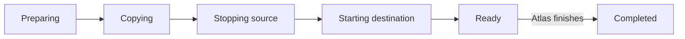

# Metal migration engine

Destination Metal drives the transfer after the Atlas app reserves a host. The Atlas app owns regional assignment and decides when to finish or abort.

## Transfer phases

| Host | Saved state |
| --- | --- |
| Destination | Migration record, reserved VM ID, and checked capacity based on the source definition. |
| Source | Lock that blocks normal VM changes. |

Normal get and list operations hide the incoming destination VM while the reservation is active, including `ready`.



The diagram shows the successful path. An abort before completion enters rollback and ends as `aborted` only after cleanup succeeds. A copy, cutover, or start fault can end as `failed`. The durable record has smaller checkpoints within each phase. A failed rollback keeps both records and locks for inspection.

## Copy the disk

1. Copy a full ZFS snapshot, then incremental changes.
2. Stop the source and remove its network before the final snapshot.
3. Receive and verify the final disk state. When `has_memory_snapshot` is true, transfer the memory snapshot in parallel and wait for both transfers.
4. Create the destination network. With a memory snapshot, restore the guest paused. Disk-only migrations apply the source's desired power state with a cold boot.

A stopped VM remains stopped. With a memory snapshot, the source uses `SaveAndStop` before it removes its network and creates the final disk snapshot. A source that is already stopped must have valid saved state. A memory snapshot migration cannot resize the VM.

The destination downloads `state`, `memory`, and `metadata.json` over the node mutual-TLS API. It verifies each SHA-256 checksum and atomically publishes the memory snapshot under `machines/<vm-id>/migration/memory-snapshot/`. The memory snapshot includes `disk-snapshot.json` with the final disk sequence and GUID. Each completed transfer has a separate checkpoint, so an interrupted memory copy does not repeat a completed disk copy. An incomplete memory copy restarts from the beginning.

Before restore, Metal verifies that the staged memory snapshot matches the final received disk snapshot GUID. It then validates the VM ID, specification and restart generations, vCPU count, memory, and disk size.

Atlas checks the host compatibility reports before starting a memory snapshot migration. Snapshot capture records the VM shape without probing the host again. Firecracker and KVM validate the saved state when they load it while the guest is paused. A load failure retains the source for rollback.

A successful load does not prove that every guest instruction is supported by the destination. Cross-model migration needs a verified common [Firecracker CPU template](https://github.com/firecracker-microvm/firecracker/blob/main/docs/cpu_templates/cpu-template-helper.md#custom-cpu-template-creation), applied before the guest first boots. Changing a template during restore cannot change what a running guest already detected. See [Firecracker CPU compatibility](https://github.com/firecracker-microvm/firecracker/blob/main/docs/snapshotting/versioning.md#cpu-model).

The saved metadata includes the source TAP gateway MAC. Before loading memory, Metal applies this MAC to the destination TAP so the guest's restored ARP and NDP caches remain valid. Source rollback also restores this MAC when it recreates the namespace.

The runtime loads the memory snapshot into a new jail with the destination's host user ID. Guest IP, MAC, TAP name, and disk path remain the same. Metal refreshes guest metadata and disk limits before it reports `ready`. The guest stays paused until Atlas commits ownership and requests `finish`.

Deploy the restore code on both hosts before enabling memory snapshot migration. Incoming snapshots must contain migration metadata with the VM shape and source TAP MAC.

At startup, the `initialize_memory_migration_flags` [host patch](../develop/metal.md#change-stored-state-with-a-patch) adds missing memory flags to existing migration records. A destination defaults to disk-only transfer. A source keeps its mode unset until cutover. The patch preserves existing flags and transfer checkpoints.

The patch can run again after an interrupted upgrade. A malformed record stops startup and reports its path.

Control calls use the node mutual-TLS listener on the source's [migration network](../region/metald.md#three-connection-roles) address. By default, this is the private IPv4 address. Disk bytes use a separate one-shot TLS stream on port `9002` of the same address:

```text
Source zfs send -> Go TLS connection -> Destination zfs receive
```

The destination verifies the snapshot GUID and can resume an interrupted receive.

## Finish or abort

The destination stays ready until the Atlas app decides:

- **Finish:** apply the destination's desired power state, destroy the stopped source, and remove transfer staging after regional assignment changes. A running VM resumes from memory. A paused VM stays paused. A stopped VM discards the loaded runtime and stays stopped.
- **Abort:** remove destination resources and restore the source if needed. Memory snapshot migrations restore the source from its retained saved state; disk-only transfers cold-start it.

An unfinished record on either host means recovery is not complete.

If the source stops but its reply is lost, cancellation restores the source before releasing its lock. A failed restore keeps the migration in rollback for retry.

After `finish` starts, an activation or cleanup fault retries forward. Abort is rejected. Activation retries inspect the existing process and do not reload an old snapshot over a disk that the guest may have changed. The jail retains its immutable memory backing file when Metal removes transfer staging, as required by [Firecracker snapshot loading](https://github.com/firecracker-microvm/firecracker/blob/main/docs/snapshotting/snapshot-support.md#loading-snapshots).

Hosts with SSH-enabled guests can set `migration.require_guest_ssh = true`. After a running guest resumes from its memory snapshot, Metal requires an SSH key-exchange response from its guest address inside the VM network namespace before source cleanup. The probe needs no guest credentials and has a ten-second timeout. A failure keeps the migration in `finishing`, retains source recovery state, and retries the check without replaying memory. Paused and stopped guests skip the probe. The setting defaults to false; it checks guest responsiveness rather than application health.

## Limits and recovery

The source allows one outbound snapshot stream at a time because streams use a fixed port. A cutover or rollback fault can keep both hosts locked. Migration needs free destination storage and a reachable private host network.

| Saved work | Recovery bound |
| --- | --- |
| Destination reservation still preparing | Expires after 10 minutes without source preparation. |
| Active source or destination record | Can expire after 15 minutes without controller contact, only while recovery is safe. A stopped source or ready destination does not expire. |
| Snapshot listener with no connection or progress | Closes after 2 minutes. |

These timers release abandoned work. They do not unlock a stopped source or discard a ready destination. Keep the records when cutover or rollback needs an operator.

An expired source keeps a tombstone that rejects the same migration ID. A later abort acknowledges cleanup without removing the tombstone. A new migration can replace it.

For API operations and schemas, use the [Metal API reference](/api/metal/). The Atlas-side decision and regional commit belong to Atlas, not this page.

::: details Source code and tests

- [Migration specification](../../metal/internal/vm/migration/SPEC.md) defines the detailed source and destination checkpoints.
- [Migration manager](../../metal/internal/vm/migration/manager.go) owns records, locks, finish, and abort.
- [Destination flow](../../metal/internal/vm/migration/destination.go) checks capacity and applies state.
- [Transfer flow](../../metal/internal/vm/migration/transfer.go) drives snapshot intervals.
- [ZFS TLS stream](../../metal/internal/storage/migration_transfer.go) moves and checks disk snapshots.
- [Migration tests](../../metal/internal/vm/migration/destination_test.go) and [stream tests](../../metal/internal/storage/migration_transfer_test.go) check recovery paths.

:::
