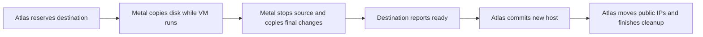

# Move a VM between hosts

Atlas picks the new host. Metal on the new host copies the disk from the old host. **The VM belongs to the new host only after Atlas records the move.** Migration can stop a running VM. Saved checkpoints let Atlas and Metal continue or roll back after a restart.

## Start a migration

1. Open **Dangerous Actions → Migrate VM** on the Virtual Machine form.
2. Select a destination Metal Server, or leave it empty for automatic placement.
3. Optionally select **Memory Snapshot**.
4. Follow the new migration record.

Atlas excludes the source host and checks destination capacity. Desk users cannot create or edit migration records directly.

The VM `migrate` method accepts the optional boolean `has_memory_snapshot`, which defaults to `false`. Atlas stores this flag and sends it to Metal when true.

The flag transfers memory during the final disk copy and restores the destination paused. After Atlas commits the new host, Metal applies the original desired power state. See the [migration engine](migration-engine.md#copy-the-disk) for compatibility checks and retry behavior.

A stopped VM also moves when a resize does not fit on its host. The migration stores `target_cpu_millicores`, `target_memory_mib`, and `target_disk_mib`, and commits the new host and shape together. On failure, the VM keeps its old host and shape. The tenant API reports `migrating` during the move.

## Compatibility before transfer

Only memory snapshot migrations require the compatibility reports stored on Metal Server by [host sync](../region/host-sync.md). Atlas compares them after destination selection and before the first Metal migration request. Missing or invalid reports fail the memory snapshot migration and release its Atlas reservation without starting a transfer.

Disk-only migrations skip these reports. Placement checks destination readiness, recent capacity, architecture, memory, and disk capacity for both modes.

| Memory snapshot migration check | Required compatibility |
| --- | --- |
| Architecture and profile | VM and host architecture match. Source and destination CPU template JSON content matches. |
| CPU | Same vendor. Native profiles also require matching host CPU model and features. |
| Runtime | Matching fingerprint of Firecracker binary contents, architecture, and host kernel release. |
| Shape | The VM shape cannot change. |
| x86 clock | Stable clock reports. A frequency difference above Firecracker's 250 ppm tolerance requires destination TSC scaling. |

The check uses the runtime's configured CPU profile. Matching configured profiles are the CPU contract. Raw host features do not describe the guest after profile masking, so they do not gate profiled migrations. The snapshot restores the source guest CPU state. Firecracker and KVM still validate the saved state when the destination loads it.

After changing a profile or replacing Firecracker, cold-boot existing VMs before migrating their memory. Atlas does not inspect each running guest's captured CPU configuration. Validate a custom profile on each supported host combination before use. See [CPU templates](cpu-templates.md#migration-validation).

## Migration sequence



Metal copies a full ZFS snapshot, then smaller changes while the VM runs. It starts cutover when the change is below `migration.final_delta_mib`, after 16 intervals, or after 30 minutes. Cutover stops the source, removes its network, and copies the final change. In a memory snapshot migration, the memory snapshot travels in parallel with the final disk change.

| Desired power state | Disk-only migration | Memory snapshot migration after finish |
| --- | --- | --- |
| Running | Boots from the copied disk. | Resumes the saved guest. |
| Stopped | Stays stopped. | Stays stopped. |
| Paused | Cold-boots, then pauses. | Keeps the restored guest paused. |

### The commit point

Atlas keeps the source host as the VM's recorded owner until the destination reports `ready`. Before that point, a failed move can still return to the source without changing the regional assignment. After the commit, Atlas retries public IP moves and asks Metal to remove the old VM.

1. Destination Metal reports `ready`.
2. Atlas commits the new host and resize values in one transaction.
3. Atlas requests public IP moves. A failed move retries on its own schedule. It does not undo the host change.
4. Atlas asks Metal to finish. Memory snapshot migrations activate the restored destination before removing the stopped source.

Atlas rejects cancellation after it commits destination ownership. A later controller error retries finish.

A temporary connection error remains visible in the migration error fields. It does not change a completed cancellation to `failed` or replace the cause of a migration failure.

Visibility and worker timeouts do not replace an existing cancellation or its failure cause.

Metal hides the incoming VM from normal reads until the move finishes.

## Migration status

| Status | Meaning |
| --- | --- |
| `scheduled` | Waiting for an eligible destination. |
| `preparing` | Destination reserved. Source preparation in progress. |
| `copying` | Full and incremental disk copies in progress. |
| `cutting_over` | Source stops. Final copy in progress. |
| `starting` | Destination VM starts. |
| `finalizing` | Atlas changes the host. Metal removes the source. |
| `canceling` | Destination cleanup and source recovery in progress. |
| `completed` | Destination owns the VM. |
| `failed` | Cannot continue automatically. |
| `aborted` | Operator cancellation and rollback completed. |

`progress_percent` estimates the whole lifecycle, not copied bytes. Use the transfer rows for copied MiB.

The transfer table labels each row as `Disk` or `Memory`. Memory snapshot migrations add one row for the memory snapshot alongside the final disk transfer. The row records transfer timing and completion. Its total starts with the VM memory size and becomes the verified combined size of state, memory, and metadata when the copy completes. Transferred bytes update at completion, as they do for disk transfers. Retries update the same row.

`memory_snapshot_status` tracks the memory snapshot separately from the migration status. The form shows it only when the read-only `has_memory_snapshot` checkbox is checked.

Metal reports `not_started` during disk precopy, `creating` while it captures and stops the source, `transferring` during the final copy, and `restoring` during destination setup. The snapshot is `completed` when the destination is loaded paused and ready. Migration finish still controls guest activation.

Rollback reports `failed` or `aborted`. Atlas stores the optional `memory_snapshot_status` response field and sets the terminal result when the migration settles. Hosts that omit this field report no intermediate snapshot progress.

## Measure SSH downtime

Run [benchmark_migration.py](../../atlas/vm/scripts/benchmark_migration.py) from the Frappe bench directory with its Python environment. One round runs memory snapshot migration in both directions, then disk-only migration in both directions. Disk-only migration cold-boots the guest. The VM must start running on one of the specified hosts, without an active migration.

```sh
env/bin/python apps/atlas/atlas/vm/scripts/benchmark_migration.py run \
  --site development.localhost --virtual-machine VM_ID \
  --host-a METAL_SERVER_A --host-b METAL_SERVER_B \
  --observer root@OBSERVER_HOST --guest-address STABLE_VM_IP \
  --output migration-timing.jsonl
```

The observer stays on one host and probes the same guest address throughout each move. Use a public or other stable address reachable from the observer on both hosts. Each probe opens a new SSH connection. The default checks SSH key exchange without guest credentials. For authenticated `ssh true` probes, pass `--identity-file` with an existing guest key path on the observer. That mode requires a matching entry in the observer's known-hosts file. The script does not install guest keys.

The JSONL output records each migration ID, mode, direction, migration duration, and every SSH outage window. `ssh_gap_seconds` measures the gap from the last successful SSH response before failure to the first successful response after recovery. Durations use the observer's monotonic clock. UTC timestamps identify the first failed probe and recovery. The control connection's latency does not enter these durations.

The default probe interval is 0.25 seconds and the probe timeout is one second. Gaps include polling and SSH handshake time; they are availability observations rather than exact guest stop/resume times. The output keeps each window separately and sums the gaps. Zero means no outage was observed. Use `--rounds` for repeated comparisons. The comparison stops after a migration failure, lost observer, timeout, or unrecovered guest. It does not cancel an unfinished migration. Temporary observer files are removed after each case.

## Failure and recovery

| Event | Behavior |
| --- | --- |
| Uncertain response | Retry with the same migration ID. Atlas polls Metal and records progress. |
| Abort before source stop | Removes destination data and unlocks the source. |
| Abort after source stop | Restores saved source memory when requested; otherwise cold-starts the source before unlocking it. |
| Finish | Valid only after `ready`. The first finish or abort wins. |
| Network interruption | Resumes the saved snapshot sequence. |
| Snapshot identity mismatch | Fails the migration and keeps data for inspection. |
| Cutover or rollback fault | Keeps both hosts and the Atlas VM action locked until recovery completes. Preserves snapshots. |

**Keep unfinished migration records** on both hosts and in Atlas. Their status and saved public IP requests can differ during recovery. The [migration engine](migration-engine.md) describes Metal's checkpoints.

::: details Source code and tests

- [Atlas migration service](../../atlas/vm/core/vm_migration.py) selects, polls, commits, and finishes.
- [VM module specification](../../atlas/vm/SPEC.md) defines the `Virtual Machine Migration` record and resize rules.
- [Metal migration manager](../../metal/internal/vm/migration/manager.go) owns host records and locks.
- [Destination transfer](../../metal/internal/vm/migration/transfer.go) owns snapshot and cutover order.
- [Metal stream](../../metal/internal/storage/migration_transfer.go) carries ZFS data over TLS.
- [Public allocation service](../../atlas/metal_server/core/public_ip_service.py) moves direct addresses after commit.
- [Atlas migration tests](../../atlas/vm/core/test_vm_migration.py) and [resize tests](../../atlas/vm/core/test_vm_resize.py) check regional state and retry.

:::
