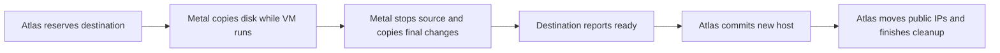

# How do I move a VM between hosts?

Atlas selects the destination host. Destination Metal copies the source disk. **Atlas changes VM ownership only after destination Metal reports `ready`.** Metal saves checkpoints so interrupted work can continue.

## How do I start a migration?

| Step | Action |
| --- | --- |
| 1 | Open **Dangerous Actions → Migrate VM** on the Virtual Machine form. |
| 2 | Select a destination Metal Server, or leave it empty for automatic placement. |
| 3 | Optionally select **Memory Snapshot**. Set **Allow Disk-Only Fallback** as described below. |
| 4 | Follow the new migration record. |

Atlas excludes the source host and checks destination readiness, recent capacity, architecture, memory, and disk capacity. Desk users cannot create or edit migration records directly.

The VM `migrate` method accepts `has_memory_snapshot`, with default `false`, and `allow_disk_only_fallback`, with default `true`. Atlas sends both options to Metal when it requests a memory snapshot.

A stopped VM also moves when a resize cannot fit on its host. Atlas stores `target_cpu_millicores`, `target_memory_mib`, and `target_disk_mib`. Atlas commits the destination and these values together. The tenant API reports `migrating` during the move.

### What does Allow Disk-Only Fallback control?

| Option | Atlas compatibility failure | Metal destination restore failure |
| --- | --- | --- |
| Selected | Atlas clears **Memory Snapshot**, records the reason, and continues with disk only. | Metal removes the failed runtime, recreates the network, and applies the desired state from disk. |
| Clear | Atlas fails before transfer with `migration_incompatible`. | Metal reports `transfer_failed`. Atlas requests rollback. |

The option does not recover every memory transfer failure. The scenario table identifies the failures that require rollback.

## Which compatibility checks apply? {#compatibility-before-transfer}

Atlas checks memory compatibility after destination selection, before its first Metal request. It uses reports from [host sync](../region/host-sync.md). Missing reports, a desired state of `stopped`, and a resize each fail this check. Disk-only migrations skip the memory compatibility check.

| Memory snapshot migration check | Required compatibility |
| --- | --- |
| Architecture and profile | VM and host architecture match. Source and destination CPU template JSON content matches. |
| CPU | CPU vendors match. Native profiles also need matching host CPU models and features. |
| Runtime | Matching fingerprint of Firecracker binary contents, architecture, and host kernel release. |
| Shape | The VM shape cannot change. |
| x86 clock | Both hosts report stable clocks. Differences above Firecracker's 250 ppm tolerance need destination TSC scaling. |

Atlas compares configured CPU profiles. Raw host features do not gate migration with a non-native profile. Firecracker and KVM validate saved CPU state when the destination loads memory.

A successful load does not prove compatibility for every guest instruction. Use a validated common CPU profile before the guest first boots.

After you change a profile or replace Firecracker, cold-boot existing VMs before their memory migration. Atlas does not inspect each guest's captured CPU configuration. Validate custom profiles on each host combination. See [CPU templates](cpu-templates.md#migration-validation).

## What happens in each migration scenario?



The tables show Atlas statuses unless they explicitly name Metal. “Original desired state” means running, paused, or stopped. A sleeping VM has saved memory and a desired state of running.

Atlas retains source ownership before commit. After `ready`, Atlas commits destination ownership and any resize in one transaction. A pending cancellation prevents this commit.

### What can happen before transfer?

| Trigger | What Atlas and Metal do | VM location and state | Visible status or error |
| --- | --- | --- | --- |
| Migrations are paused, or the VM is not running, stopped, or paused | Atlas rejects creation. Active migrations continue when new migrations are paused. | Source, unchanged. | User error. No new migration. |
| The VM is draft, terminating, already migrating, or changing its public address | Atlas rejects creation. | Source, unchanged. | User error. No new migration. |
| Automatic placement finds no destination | Atlas records the selection failure and retries through the reconciler. | Source, unchanged. | `scheduled`, with selection attempts and a message. |
| The requested destination is unavailable or equals the source | Atlas rejects placement and releases its VM action lock. | Source, unchanged. | `failed`, `destination_unavailable`. |
| Memory compatibility fails and fallback is selected | Atlas clears `has_memory_snapshot` and requests disk-only transfer. | Source until cutover. Destination then uses the original desired state. | `preparing`. **Error Message** explains the skipped memory snapshot. |
| Memory compatibility fails and fallback is clear | Atlas releases its reservation without a Metal transfer. This includes stopped VMs and resize requests. | Source, with its original state and shape. | `failed`, `migration_incompatible`. |
| A destination request has an uncertain response | Atlas repeats the same migration ID and polls. Metal returns matching active work or the settled result. | Current host and runtime state remain unchanged by the repeated request. | Current migration status, possibly `metal_client_error`. |
| A direct Metal request changes an active migration or conflicts with existing resources | Metal rejects the request. Atlas treats a nonretryable client exception as a worker error. | Existing VM resources remain. Atlas recovery follows current ownership. | Metal HTTP 409, `conflict`. Atlas can record `migration_worker_error`. |
| Metal cannot prepare the source or reserve capacity | Metal records the error and retries preparation. | Source, unchanged. Destination remains reserved. | `preparing`. Metal records `migration_error`. |
| Preparation exceeds 10 minutes from destination creation | Metal starts destination cleanup and source recovery. | Source after cleanup, in its original desired state. | Metal phase `rollback`, then `aborted`. Atlas settles from the recorded cause. |

### What can happen during copy?

| Trigger | What Atlas and Metal do | VM location and state | Visible status or error |
| --- | --- | --- | --- |
| The source runs | Metal copies a full ZFS snapshot, then incremental changes. | Source, running until cutover. | `copying`. Transfer rows show completed copies. |
| The source is paused, stopped, or sleeping | Metal skips live copy and enters cutover before the full disk transfer. | Source stops before transfer. Atlas still records source ownership. | `copying` during the full final transfer. |
| Metal completes 16 intervals, exceeds 30 minutes after copy starts, or sees a small delta | Metal enters cutover between intervals. The delta threshold is `migration.final_delta_mib`, with default 512 MiB. | Source stops for the final delta. | `cutting_over`, or `copying` without an earlier interval. |
| A stream or host worker stops temporarily | Metal retries from saved checkpoints. Completed disk and memory transfers remain complete. | Source before cutover. Source stays stopped after cutover. | Current phase remains visible. Metal logs the interruption. |
| A memory download fails its size or checksum check | Metal retries the memory copy. This error does not trigger disk-only fallback. | Source stays stopped. Destination waits for verified memory. | `copying` or `cutting_over`, with Metal interruption logs. |
| A snapshot GUID differs, the final sequence is invalid, or an unrelated destination dataset exists | Metal preserves transfer data and reports failure. Atlas requests rollback. | Source after rollback, in its original desired state. | Metal `failed`, `transfer_failed`. Atlas `canceling`, then `failed`. |
| Copy exceeds disk size at 25 MiB/s plus 1 hour | Atlas requests rollback only while Metal reports `preparing` or `copying`. Cancellation disables this limit. | Source after rollback, in its original desired state. | `canceling`, then `failed`, with `copy_timeout`. |
| Destination polls fail for 10 minutes since the last successful poll | Atlas records failure and requests abort. Each successful poll resets the timer. | Source remains the recorded owner. Runtime state depends on cutover and recovery. | `destination_unreachable`. Cleanup stays pending until Metal responds. |
| An Atlas worker reaches its 30-minute run limit | The worker yields. The per-minute reconciler queues another run. | Current host and runtime state remain unchanged. | Current status remains visible. |
| A deadlock, lock wait timeout, RQ job timeout, or retryable Metal error interrupts Atlas | Atlas resumes through reconciliation. Connection errors can record `metal_client_error`. | Current host and runtime state remain unchanged. | No terminal failure from the transient error. |
| Another Atlas worker error occurs | Atlas records failure. Recovery requests abort before commit and finish after commit. | Source before commit. Destination after commit. Recovery can remain pending. | `migration_worker_error`. `canceling` before commit, `finalizing` after commit. |

The copy deadline starts at `started_at`. A 100 GiB disk gets about 2 hours 8 minutes. Metal's 30-minute copy budget does not interrupt an active interval.

Atlas starts each worker run with a fresh destination visibility timer. A temporary client error cannot replace a definite failure or change a terminal result. The visibility timeout cannot replace an existing cancellation or its cause.

### What can happen at cutover and start?

| Trigger | What Atlas and Metal do | VM location and state | Visible status or error |
| --- | --- | --- | --- |
| Disk-only migration reaches cutover | Metal stops the source, removes its network, and copies the final disk. | Destination cold-boots for running, cold-boots then pauses for paused, or stays stopped. | `cutting_over`, `starting`, then `finalizing`. |
| A sleeping VM uses disk-only migration | Metal restores saved source memory, then stops the source normally. | Destination cold-boots and runs. Saved guest memory does not move. | `copying`, `starting`, then `finalizing`. |
| Memory snapshot migration reaches cutover | Metal saves source memory and transfers it beside the final disk. | Source stops. Destination loads the guest paused until finish. | `memory_snapshot_status`: `creating`, `transferring`, `restoring`, then `completed`. |
| A sleeping VM uses a memory snapshot | Metal transfers its saved state without a source wake. | Destination loads paused, then resumes at finish. | `memory_snapshot_status` reaches `completed`. |
| Source memory is unavailable | `SaveAndStop` returns a conflict. Metal maps `ErrNoMemoryToSave` to a definite transfer failure, regardless of fallback. | Source remains the owner. Atlas requests rollback. | Source API: HTTP 422, `memory_snapshot_unavailable`. Destination: `transfer_failed`. Atlas eventually `failed`. |
| Destination memory restore fails and fallback is selected | Metal removes the runtime, recreates the network, and applies disk-only state. Atlas continues. | Destination uses the original desired state after a cold boot, if needed. | Metal retains `memory_snapshot_error`. `memory_snapshot_status` stays `failed`, including after migration status `completed`. |
| Fallback runtime cleanup or network creation fails | Metal retries cleanup before it records fallback and applies disk-only state. | Source stays stopped. Destination setup remains incomplete. | `starting`, with Metal interruption logs. |
| Destination memory restore fails and fallback is clear | Metal reports failure. Atlas requests source recovery. | Source returns to its original desired state after rollback. | `transfer_failed`, then Atlas `failed`. |
| Destination network setup or disk-only start fails | Metal reports failure. Atlas requests rollback. | Source returns to its original desired state after rollback. | `transfer_failed`, then Atlas `failed`. |

### What can happen after commit?

| Trigger | What Atlas and Metal do | VM location and state | Visible status or error |
| --- | --- | --- | --- |
| Atlas commits destination ownership | Atlas requests public IP moves and Metal finish. Metal activates saved memory before source removal. | Destination resumes for running, remains paused for paused, or stays stopped. | `finalizing`, then `completed`. |
| A public IP move fails | The allocation service retries on its own schedule. Atlas keeps destination ownership. | Destination. Guest state follows finish. Public IP recovery can remain pending. | Migration can complete. The allocation can remain `Attaching` with `failure_message`. |
| Resume returns an error | Metal inspects the guest. A running guest keeps memory. A paused guest retries resume. | Destination, running or paused until recovery succeeds. | `finalizing`. Metal remains `finishing` on an unresolved error. |
| The restored process disappears or fails | Metal cold-boots the current disk. It preserves disk writes after activation. | Destination, in its desired state after recovery. RAM state is lost. | `finalizing` until activation succeeds. |
| A failed cold boot leaves `StateCreated` | Metal removes the incomplete runtime and retries a cold boot. | Destination reaches its desired state after recovery. | `finalizing` until recovery succeeds. |
| Recovery boots a paused VM, but pause fails | Metal retries only pause on the running process. | Destination runs temporarily, then pauses. | `finalizing` until pause succeeds. |
| The optional guest SSH check fails | Metal retries the check and retains source recovery data. Paused and stopped guests skip the check. | Destination, running. | `finalizing`, Metal `finishing`. |
| Activation, source removal, or staging cleanup fails | Metal retries forward. Atlas requests finish again. | Destination remains the owner. Source recovery data can remain until cleanup succeeds. | `finalizing`, then `completed` after recovery. |

### What can happen during cancellation and rollback?

| Trigger | What Atlas and Metal do | VM location and state | Visible status or error |
| --- | --- | --- | --- |
| The operator aborts a scheduled migration | Atlas releases the VM action lock without transfer. | Source, unchanged. | `aborted`. |
| The operator aborts before commit and source stop | Atlas requests abort. Metal removes destination data and releases the source lock. | Source, with its original state. | `canceling`, then `aborted`. |
| The operator aborts after source stop, before commit | Metal removes destination resources, then restores the source before unlock. | Source resumes saved memory for memory mode. Disk-only mode applies the original desired state from disk. | `canceling`, then `aborted`. |
| The source stop reply is lost | Source unlock rejects the stopped source. Destination recovery switches to source restore. | Source reaches its original desired state before unlock. | `canceling` until rollback completes. |
| Source memory restore returns an error | Metal inspects the guest. A guest in its desired state keeps memory. Otherwise Metal cold-boots the disk. | Source reaches its original desired state. This also recovers sleeping VMs to running. | `canceling` until rollback completes. |
| A source cold boot runs, but pause fails | The next restore pass only pauses the running process. | Source runs temporarily, then pauses. | `canceling` until rollback completes. |
| Rollback cleanup, restore, or cold boot fails | Metal retains checkpoints and locks, then retries. | Atlas keeps source ownership. Runtime state depends on the failed step. | `canceling`. Metal phase `rollback`. |
| Failure causes the abort | Atlas preserves the failure code through cleanup. | Source, in its original desired state after recovery. | `canceling`, then `failed`. A client error alone permits `aborted`. |
| The operator aborts after commit | Atlas rejects abort and continues finish. Metal also rejects abort after finish starts. | Destination remains the owner. | Atlas user error. Metal HTTP 409, `conflict`. |
| Finish and abort requests compete at Metal | Metal accepts finish only from `ready`. The first accepted intent controls recovery. | Destination after finish, or source after abort. | A conflicting request returns HTTP 409, `conflict`. |
| Destination control contact stops for 15 minutes | Metal rolls back abandoned work, including failed transfers. Ready, finishing, and rollback states do not expire. | Source after successful rollback, in its original desired state. | Metal `rollback`, then `aborted`. Atlas needs contact to settle. |
| A pre-stop source has no contact for 15 minutes | Metal expires its lock only when no source stream runs. It restores disk limits and removes migration snapshots. | Source, with its current runtime state. | Source record `expired`. The same migration ID cannot restart it. |
| A source is stopped or a destination is ready | Metal does not expire these records automatically. | Source remains locked, or destination remains ready, until recovery continues. | Current migration status remains visible. |

The **Abort Migration** button sends the record name. The server reads the latest record and locks the VM before the migration record. This avoids a stale form save while the worker records progress.

**Keep unfinished migration records** on both hosts and in Atlas. Use [Metal checkpoints and recovery](migration-engine.md) to inspect interrupted work.

## How do I read migration progress?

| Atlas status | Meaning |
| --- | --- |
| `scheduled` | Atlas waits for an eligible destination. |
| `preparing` | Atlas reserves the destination. Metal prepares the source. |
| `copying` | Metal copies disk snapshots. |
| `cutting_over` | Metal stops the source and copies final changes. |
| `starting` | Metal creates the destination network and applies VM state. |
| `finalizing` | Atlas commits ownership. Metal finishes activation and cleanup. |
| `canceling` | Metal removes destination resources and recovers the source. |
| `completed` | Atlas records destination ownership. Metal completes cleanup. |
| `failed` | Migration fails. A transfer failure reaches this status after rollback. |
| `aborted` | Cancellation and cleanup complete. |

`progress_percent` estimates lifecycle progress. Use transfer rows for copied MiB. Each row identifies a `Disk` or `Memory` transfer. Bytes update at completion. Retries update the same sequence row.

A memory row starts with the VM memory size. Its final total includes the verified state, memory, and metadata files.

Metal reports `memory_snapshot_status` as `not_started` before memory capture. The form shows this field only when `has_memory_snapshot` is selected. Hosts that omit this response field show no intermediate memory progress. Atlas stores a fallback reason in **Error Message** unless a definite migration failure takes precedence.

## How do I measure SSH downtime?

Run [benchmark_migration.py](../../atlas/vm/scripts/benchmark_migration.py) from the Frappe bench directory with its Python environment. Each round runs memory snapshot migration in both directions, then disk-only migration in both directions.

The VM must run on one specified host without an active migration. Disk-only migration cold-boots the guest.

```sh
env/bin/python apps/atlas/atlas/vm/scripts/benchmark_migration.py run \
  --site development.localhost --virtual-machine VM_ID \
  --host-a METAL_SERVER_A --host-b METAL_SERVER_B \
  --observer root@OBSERVER_HOST --guest-address STABLE_VM_IP \
  --output migration-timing.jsonl
```

The observer stays on one host and probes the same guest address throughout each move. Use a stable address that the observer can reach on both hosts. Each probe opens a new SSH connection. The default probe checks SSH key exchange without guest credentials.

For authenticated `ssh true` probes, pass `--identity-file` with an existing guest key path on the observer. The observer also needs a matching entry in its known-hosts file. The script does not install guest keys.

| Measurement | Meaning |
| --- | --- |
| JSONL output | JSON Lines records contain the migration ID, mode, direction, duration, and each SSH outage window. |
| `ssh_gap_seconds` | Time from the last successful SSH response before failure to the first successful response after recovery. |
| Duration clock | The observer uses its monotonic clock. Control connection latency does not affect these durations. |
| UTC timestamps | Coordinated Universal Time identifies the first failed probe and recovery. |
| Probe defaults | The interval is 0.25 seconds. Each probe has a 1-second timeout. |
| Outage total | The output retains each window and sums its gaps. Zero means the observer detects no outage. |

Gaps include probe intervals and SSH handshake time. They measure observed availability, rather than exact guest stop and resume times. Use `--rounds` to repeat comparisons.

The comparison stops after a migration failure, observer loss, timeout, or failure to recover the guest. It leaves unfinished migrations active. The script removes temporary observer files after each case.

::: details Source code and tests

| Source | Purpose |
| --- | --- |
| [Atlas migration service](../../atlas/vm/core/vm_migration.py) | selects, polls, commits, and finishes. |
| [VM module specification](../../atlas/vm/SPEC.md) | defines the `Virtual Machine Migration` record and resize rules. |
| [Metal migration manager](../../metal/internal/vm/migration/manager.go) | owns host records and locks. |
| [Destination transfer](../../metal/internal/vm/migration/transfer.go) | owns snapshot and cutover order. |
| [Metal stream](../../metal/internal/storage/migration_transfer.go) | carries ZFS data over TLS. |
| [Public allocation service](../../atlas/metal_server/core/public_ip_service.py) | moves direct addresses after commit. |
| [Atlas migration tests](../../atlas/vm/core/test_vm_migration.py) and [resize tests](../../atlas/vm/core/test_vm_resize.py) | Check regional state and retry. |

:::
