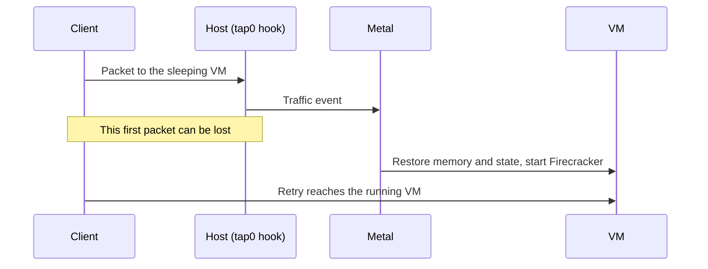

# Sleepy VMs

A **sleepy VM** is one that Metal saves and stops after an idle period. Metal restores it when new traffic arrives. While it sleeps, it uses no CPU or memory on the host, so a host can hold many more quiet VMs. It suits sites and VMs that are idle most of the day.

A VM is sleepy when `sleep_after_idle_seconds` is greater than `0`. Set it when you create the VM or with a resize. `0` turns sleeping off.

## How it sleeps and wakes

An explicit stop ends both states. Setting the timeout to `0` wakes a sleeping VM and turns sleeping off.

**Going to sleep:**

1. Metal watches traffic sent from the host to the VM.
2. Every 5 seconds, reconciliation checks running sleepy VMs with no pending change or error.
3. After the idle timeout, Metal saves memory and device state under `machines/<id>/saved-state/` and stops Firecracker.
4. Metal checks traffic again. If a packet arrived during the save, it restores the VM.

**Waking up.** An eBPF hook on the VM's `tap0` sees the next packet and tells Metal. Metal restores the saved state, and the VM carries on from where it stopped: open files and processes are intact.



Only real traffic counts: unicast IPv4 or IPv6 packets from the host to the VM, except ICMP. Traffic the VM sends, ICMP such as ping, ARP, and IPv6 multicast chatter do not keep it awake or wake it.

## What the state looks like

| Record | While sleeping |
| --- | --- |
| Desired state | `running`. Nobody asked the VM to stop. |
| Observed state | `stopped`. Firecracker is not running. |
| Sleep state | `sleeping`. See the values below. |
| Atlas list | Shows the last reported state, `stopped`. |

Metal reports the sleep state as `observed.sleep_state`. Atlas shows it as **Sleep State** on the VM. The sleep state tells where Metal keeps the saved state:

| Sleep state | Saved memory | Disk |
| --- | --- | --- |
| Empty | None. The VM is awake. | On the host |
| `sleeping` | On the host | On the host |
| `deep-sleeping` | In object storage | On the host |
| `comatose` | In object storage | In object storage |

Metal sets `deep-sleeping` after it uploads and removes local saved memory. It sets `comatose` after it also uploads and removes the local disk. A host with an older `metald` does not send the field, so Atlas shows the VM as awake.

The saved state belongs to one VM. It is not the shared [warm artifact](../storage/host-storage.md#snapshots-and-warm-artifacts) that speeds up a VM's first boot.

## Configure automatic offload

Atlas checks sleepy VMs every minute. It compares Metal's `observed.last_request_at` with **Deep Sleep After Idle (Seconds)** and **Coma After Idle (Seconds)** on each Virtual Machine. Both times start at the last request, not when the VM entered sleep. `0` disables that transition. Coma requires a shorter, nonzero deep-sleep threshold.

Set the delays in the create API request or with **Actions → Resize VM**. New VMs default both offload delays to `0`. Atlas stores these two values locally and does not include them in Metal compute or resize requests. An offload-only update does not contact Metal or wake the VM.

At the deep-sleep threshold, Atlas supplies signed memory upload and download URLs. At the coma threshold, it also supplies disk URLs. If both thresholds have passed, it requests both artifacts together. Atlas skips awake, draft, terminating, and migrating VMs. Missing request timestamps do not trigger an upload.

Upgrade the target Metal hosts and configure **Object Storage** in Atlas Settings before enabling offload. Atlas uses `sleep/<site>/<server>/<vm>/memory` and `disk` as object keys. A later sleep checkpoint on the same host replaces these objects. The host prefix separates uploads across migration. Keep these objects available while the VM depends on them.

The same job refreshes GET URLs for stored checkpoints once an hour, even when offload thresholds are disabled. The interval is fixed and does not depend on URL expiry. Set the signed URL lifetime longer than one hour and allow time for queue delays and downloads.

Atlas caches each successful refresh per VM and checkpoint for one hour. A cache miss refreshes URLs immediately. A failed check appears in Error Log and retries on the next minute's schedule. Atlas does not store signed URLs or a second copy of Metal's sleep state.

## Upload saved snapshots

Atlas can offload snapshots with `POST /v1/vms/{id}/sleep-state`. The VM must already be sleeping. Supply presigned PUT and GET URLs for memory, disk, or both. Upload memory before disk. Atlas can request both together or add disk in a later request.

After each successful upload, Metal removes the matching local artifact to free host storage. An upload failure keeps the artifact needed for recovery. Metal records the remote checkpoint before it removes local data, so reconciliation can finish an interrupted eviction.

```json
{
  "memory": {
    "upload_url": "https://objects.example/sleep/checkpoint/memory?signature=...",
    "download_url": "https://objects.example/sleep/checkpoint/memory?signature=..."
  },
  "disk": {
    "upload_url": "https://objects.example/sleep/checkpoint/disk?signature=...",
    "download_url": "https://objects.example/sleep/checkpoint/disk?signature=..."
  }
}
```

Each upload URL must accept a complete object with HTTP PUT. Memory is a zstd-compressed tar archive of `state`, `memory`, and `metadata.json`. Disk uses the zstd-compressed raw image format. Metal records each artifact's SHA-256 digest and size. The digest covers the uncompressed content, including the tar headers for memory.

The request returns `202` and the VM response. Poll `observed.sleep_snapshot` for the checkpoint ID, artifact details, and `uploaded` flags. `observed.phase` reports upload work and `observed.error` reports a failure. Signed URLs stay out of responses and logs. A repeated request for the same checkpoint does not upload a completed artifact again.

In Desk, open or refresh the VM form during an offload. The **Snapshot Upload** bar below **Sleep State** shows progress only while Metal uploads memory or disk over HTTP. Refresh the form to update the value. The field is hidden outside uploads, including preparation, compression, completion, and failure. Progress is not stored in Atlas.

Atlas can store refreshed GET URLs with `PATCH /v1/vms/{id}/sleep-state`:

```json
{
  "snapshot_id": "<observed.sleep_snapshot.id>",
  "memory": {
    "download_url": "https://objects.example/sleep/checkpoint/memory?signature=..."
  }
}
```

An omitted artifact keeps its GET URL. A refresh must name the stored checkpoint and keep each URL's scheme, host, and object path. It cannot supply an upload URL. This request stores URLs only. It does not download artifacts or wake the VM.

Uploads use stable staging data, so a wake can proceed during upload. Upload completion does not evict data if the VM has already woken. The upload status belongs to its checkpoint ID. A request for a later sleep checkpoint creates a new ID.

Staging, compression, and uploads run in a separate pool of two background workers. Slow object storage does not consume normal VM reconciliation workers. The daemon cancels and waits for upload workers during shutdown. A later pass retries incomplete transfers after restart.

## Wake an offloaded VM

Traffic and an explicit start use one restore path for all sleep states. For a comatose VM, Metal first recovers a missing disk. For either remote sleep state, it then recovers missing memory and calls the normal saved-state restore. It verifies artifact checksums and checkpoint metadata before use. A completed local download can be reused on retry.

Start returns `202` after it saves the wake request. Restores run in a separate pool of two background workers, independent of uploads and normal VM reconciliation. Poll the VM response for `observed.phase`, `observed.error`, and completion. A repeated pending start returns without waiting for the download. The daemon cancels and waits for restore workers at shutdown, and a saved wake request resumes after restart.

A download or restore failure leaves the VM asleep and reports `observed.error`. Metal rearms traffic events after a failed wake and retries pending requests. If a GET URL expires, Atlas refreshes it with PATCH. PATCH stores URLs only. It does not create a wake request, but a pending wake uses the new URLs on retry. Metal does not fall back to a cold boot after a wake failure.

An explicit stop, restart, or shape change recovers an offloaded disk before it discards saved memory. Wake an offloaded VM before migration. A migration request for a deep-sleeping or comatose VM returns `409`.

## Placement

Sleepy VMs can live on their own hosts. With **Use Dedicated Sleepy VM Hosts** on in Atlas Settings, sleepy VMs go only to sleepy hosts, and regular VMs only to regular hosts. Auto-spawn creates a host for the right pool.

Because most sleepy VMs are asleep at any time, the `balanced` strategy divides sleepy memory by `sleepy_vm_overcommit_factor` when it ranks hosts. The capacity check still uses real free memory. `spread-3` and `best-fit` pack sleepy VMs onto the fullest sleepy host. See [placement](placement.md#strategies).

## Limits and recovery

- **The first packet can be lost** while the VM wakes. Clients must retry, as they would on any network.
- **Migration keeps the memory only with a memory snapshot.** A memory snapshot migration sends the saved state, and the VM resumes awake on the new host. A disk-only migration wakes the VM, shuts it down, and cold-boots it on the new host.
- **Some actions throw the saved state away:** an explicit stop, a restart, a shape change, or deleting the VM. The next start is a normal boot.
- **A failed restore keeps the saved state** for another try. Metal never cold-boots instead, because that would lose the VM's memory without warning. The exception is a migration rollback: Metal cold-boots the source so the migration cannot stay stuck.
- A `metald` restart resets the idle clock, so a VM can sleep later than expected, never earlier.
- A start resets the idle clock, so a VM is never put to sleep before the guest has booted.

To check a sleepy VM, see [Automatic idle shutdown](../operate/metal.md#automatic-idle-shutdown-does-not-stop-or-restore-a-vm) in the Metal runbook.

::: details Source code and tests

- [Idle watcher](../../metal/internal/vm/idle_watcher.go) decides when to save and when to restore.
- [Traffic monitor](../../metal/internal/network/traffic/monitor.go) and [eBPF program](../../metal/internal/network/traffic/bpf/track_traffic.c) record host-to-guest traffic.
- [Firecracker machine](../../metal/internal/firecracker/machine.go) saves and restores the VM state.
- [Placement strategies](../../atlas/vm/core/placement/strategies/balanced.py) apply the sleepy pools and overcommit factor.

:::
