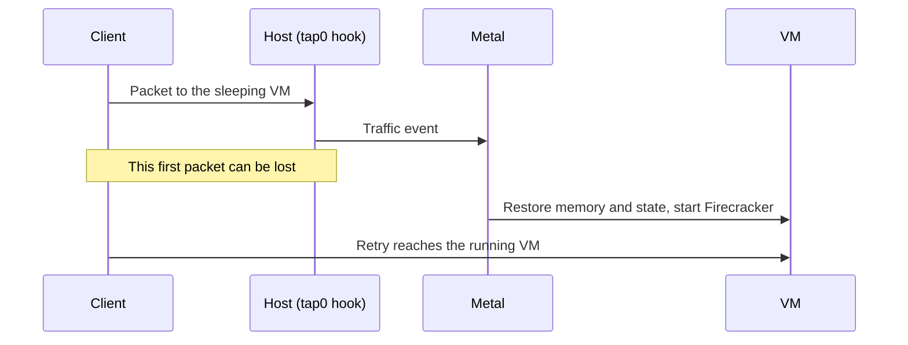

# Sleepy VMs

A **sleepy VM** is one that Metal saves and stops after an idle period. Metal restores it when new traffic arrives. While it sleeps, it uses no CPU or memory on the host, so a host can hold many more quiet VMs. It suits sites and VMs that are idle most of the day.

A VM is sleepy when `sleep_after_idle_seconds` is greater than `0`. Set it when you create the VM or with a resize. `0` turns sleeping off. An idle-only resize applies the timeout to Metal and stores the same value in the Atlas VM record.

## How it sleeps and wakes

An explicit stop ends both states. Setting the timeout to `0` wakes a sleeping VM and turns sleeping off.

**Going to sleep:**

1. Metal watches traffic sent from the host to the VM.
2. Every 5 seconds, reconciliation checks running sleepy VMs with no pending change or error.
3. After the idle timeout, Metal saves memory and device state under `machines/<id>/saved-state/` and stops Firecracker.
4. Metal checks traffic again. If a packet arrived during the save, it restores the VM.

**Waking up.** An eBPF hook on the VM's `tap0` sees the next packet and tells Metal. Metal restores the saved state, and the VM carries on from where it stopped: open files and processes are intact.



Only real traffic counts: unicast IPv4 or IPv6 packets from the host to the VM, except ICMP. Traffic the VM sends, ICMP such as ping, ARP, and IPv6 multicast chatter do not keep it awake or wake it.

## What the state looks like

| Record | While sleeping |
| --- | --- |
| Desired state | `running`. Nobody asked the VM to stop. |
| Observed state | `stopped`. Firecracker is not running. |
| Sleep state | `sleeping`. See the values below. |
| Atlas list | Shows the last reported state, `stopped`. |

Metal reports the sleep state as `observed.sleep_state`. Atlas shows it as **Sleep State** on the VM. The sleep state tells where Metal keeps the saved state:

| Sleep state | Saved memory | Disk |
| --- | --- | --- |
| Empty | None. The VM is awake. | On the host |
| `sleeping` | On the host | On the host |
| `deep-sleeping` | In object storage | On the host |
| `coma` | In object storage | In object storage |

Metal sets `deep-sleeping` after it uploads and removes local saved memory. It sets `coma` after it also uploads and removes the local disk. A host with an older `metald` does not send the field, so Atlas shows the VM as awake.

The saved state belongs to one VM. It is not the shared [warm artifact](../storage/host-storage.md#snapshots-and-warm-artifacts) that speeds up a VM's first boot.

## Configure automatic offload

Every minute, Atlas reads the sleep state and last request time that host sync stored on each **Virtual Machine State**. It compares the last request time with **Deep Sleep After Idle (Seconds)** and **Coma After Idle (Seconds)** on each Virtual Machine. Both times start at the last request, not when the VM entered sleep. `0` disables that transition. Coma requires a shorter, nonzero deep-sleep threshold.

Deep sleep and coma are allowed only for a VM with at most 4 GiB of memory and 50 GiB of disk. Atlas rejects a create, resize, or disk resize that sets a threshold on a larger VM, or that makes a VM with a threshold larger.

Set the delays in the create or resize API request, or with **Actions → Edit Sleep Configuration**. New VMs default both offload delays to `0`. Atlas stores these two values locally and does not include them in Metal compute or resize requests. An offload-only update does not contact Metal or wake the VM.

At the deep-sleep threshold, Atlas supplies signed memory upload and download URLs. At the coma threshold, it also supplies disk URLs. If both thresholds have passed, it requests both artifacts together. Atlas skips awake, draft, terminating, and migrating VMs, and VMs above the size limit. Missing request timestamps do not trigger an upload.

Atlas signs each artifact as parts of 512 MiB, enough for the uncompressed size. Metal uses only the parts that it needs. Only a VM with due work gets a job, and only that job calls Metal.

Upgrade the target Metal hosts and configure **Object Storage** in Atlas Settings before enabling offload. Atlas names each new checkpoint and stores it in a directory with the same name, `sleep/<site>/<vm>/<checkpoint>/`, with `memory.<n>` and `disk.<n>` parts. A checkpoint from an older Atlas uses `sleep/<site>/<server>/<vm>/memory` and `disk`. An artifact keeps its object key after migration.

## Keep download URLs valid

A wake from deep sleep or coma downloads the artifacts with the signed GET URLs that Metal stored. An expired URL fails the wake. Atlas stores **Download URLs Expire At** on the **Virtual Machine State**. It signs new URLs when half of their lifetime has passed, so an Atlas outage shorter than half the lifetime cannot stop a wake.

**Signed URL Expiry (seconds)** in Atlas Settings sets the lifetime, from one hour to seven days. The default is one day. A change to it or to the object storage credentials makes Atlas sign new URLs for every checkpoint on the next minute, because a new key makes the old signatures invalid. New URLs also retry a wake that failed on expired URLs.

A failed check appears in Error Log at most once an hour per VM. It retries on the next minute's schedule.

## Delete unused objects

Each check of a sleeping or awake VM deletes every checkpoint directory of that VM except the current checkpoint. An awake VM keeps no objects. Atlas sets **Download URLs Expire At** before it asks Metal to upload, so a VM that wakes after any upload gets this check.

When Atlas deletes a VM, it deletes all of its sleep objects. A daily job also deletes the objects of VMs that no longer exist, in case that deletion failed.

## Upload saved snapshots

Atlas can offload snapshots with `POST /v1/vms/{id}/sleep-state`. The VM must already be sleeping. Supply presigned PUT and GET URLs for memory, disk, or both. Upload memory before disk. Atlas can request both together or add disk in a later request.

After each successful upload, Metal removes the matching local artifact to free host storage. An upload failure keeps the artifact needed for recovery. Metal records the remote checkpoint before it removes local data, so reconciliation can finish an interrupted eviction.

```json
{
  "memory": {
    "upload_url": "https://objects.example/sleep/checkpoint/memory?signature=...",
    "download_url": "https://objects.example/sleep/checkpoint/memory?signature=..."
  },
  "disk": {
    "upload_url": "https://objects.example/sleep/checkpoint/disk?signature=...",
    "download_url": "https://objects.example/sleep/checkpoint/disk?signature=..."
  }
}
```

An object store limits one PUT to 5 GiB. For a larger artifact, send `part_size_bytes` and a `parts` list instead of the two URLs. Each part has its own `upload_url` and `download_url`. Metal compresses the artifact into consecutive parts of that size as it reads, so it never holds a full compressed copy on the host. Sign enough parts for the uncompressed size. Metal uses only the parts it needs, reports their number in `artifact.part_count`, and forgets the rest.

```json
{
  "disk": {
    "part_size_bytes": 536870912,
    "parts": [
      {"upload_url": "https://objects.example/sleep/checkpoint/disk.1?signature=...", "download_url": "https://objects.example/sleep/checkpoint/disk.1?signature=..."},
      {"upload_url": "https://objects.example/sleep/checkpoint/disk.2?signature=...", "download_url": "https://objects.example/sleep/checkpoint/disk.2?signature=..."}
    ]
  }
}
```

Each upload URL must accept a complete object with HTTP PUT. Memory is a zstd-compressed tar archive of `state`, `memory`, and `metadata.json`. Disk uses the zstd-compressed raw image format. Metal records each artifact's SHA-256 digest and size. The digest covers the uncompressed content, including the tar headers for memory.

The request returns `202` and the VM response. Poll `observed.sleep_snapshot` for the checkpoint ID, artifact details, and `uploaded` flags. `observed.phase` reports upload work and `observed.error` reports a failure. Signed URLs stay out of responses and logs. A repeated request for the same checkpoint does not upload a completed artifact again. The first request for a new checkpoint can set `snapshot_id`, so the controller can name its objects after the checkpoint. Without it, Metal chooses the ID. A later request for the same checkpoint must use the same ID.

In Desk, each **Virtual Machine State** shows the **Sleep State**, **Last Request At**, and **Sleep Checkpoint** that the host reported in its last sync. It also shows **Download URLs Expire At**, which Atlas sets. Atlas does not store upload progress. Read `observed.phase` from Metal for that.

Atlas can store refreshed GET URLs with `PATCH /v1/vms/{id}/sleep-state`:

```json
{
  "snapshot_id": "<observed.sleep_snapshot.id>",
  "memory": {
    "download_url": "https://objects.example/sleep/checkpoint/memory?signature=..."
  }
}
```

An omitted artifact keeps its GET URL. A refresh must name the stored checkpoint and keep each URL's scheme, host, and object path. A split artifact needs one `download_url` for each of its `part_count` parts, in order. It cannot supply an upload URL. This request stores URLs only. It does not download artifacts or wake the VM.

Artifact status includes `object_key` when stored. Set it with the optional `object_key` field in an upload or URL refresh request. A nonempty key cannot change within a checkpoint. Atlas fills missing keys before migration. Older hosts ignore this optional request field.

Uploads use stable staging data, so a wake can proceed during upload. A wake, or any other change to the VM, cancels a running upload, because the VM no longer needs its checkpoint. No part reaches object storage after Atlas deletes the checkpoint objects. The upload status belongs to its checkpoint ID. A request for a later sleep checkpoint creates a new ID.

Staging, compression, and uploads run in a separate pool of eight background workers. Slow object storage does not consume normal VM reconciliation workers. The daemon cancels and waits for upload workers during shutdown. A later pass retries incomplete transfers after restart.

## Wake an offloaded VM

Traffic and an explicit start use one restore path for all sleep states. For a VM in coma, Metal first recovers a missing disk. For either remote sleep state, it then recovers missing memory and calls the normal saved-state restore. It verifies artifact checksums and checkpoint metadata before use. A completed local download can be reused on retry.

Start returns `202` after it saves the wake request. Normal VM reconciliation restores memory that is on the host. VMs in deep sleep or coma restore in a separate pool of eight background workers, so a slow download does not delay other VMs. Poll the VM response for `observed.phase`, `observed.error`, and completion. A repeated pending start returns without waiting for the download. The daemon cancels and waits for restore workers at shutdown, and a saved wake request resumes after restart.

A download or artifact validation failure leaves the VM asleep and reports `observed.error`. Metal rearms traffic events after a failed wake and retries pending requests. If a GET URL expires, Atlas refreshes it with PATCH. PATCH stores URLs only. It does not create a wake request, but a pending wake uses the new URLs on retry.

If runtime restore fails after artifact preparation, Metal checks whether the guest already reached the requested state. If not, it keeps the saved memory and tries again. After 3 failed attempts since metald started, it removes the failed runtime and saved memory, then cold-boots the existing disk. This keeps the disk but loses processes and unsaved memory. A VM in coma must recover its disk first.

Cancellation and timeout errors retry without a cold boot. Metal logs the fallback and prevents later retries from loading the old remote memory. Cleanup and cold-boot failures report `observed.error`.

An explicit stop, restart, or shape change recovers an offloaded disk before it discards saved memory. [Migration](migration.md#move-an-offloaded-vm) moves an offloaded VM without waking it or downloading its snapshots.

## Automatic host rebalancing

Every minute, Atlas checks ready sleepy hosts, including hosts in maintenance. It adds the configured memory of running and paused VMs and compares the sum with host memory. It does not use guest RSS or discount the sum by the sleepy overcommit factor.

At 85% or more, Atlas selects sleepy VMs that are sleeping, deep-sleeping, or in coma. Above 90%, it also selects running sleepy VMs. Paused VMs count toward pressure but do not move automatically.

Running candidates rank by the fewest completed migrations in the last 24 hours, then largest memory, then VM name. Atlas selects enough running candidates to bring projected source pressure toward 85%. Sleeping candidates follow, largest memory first. There is no fixed VM-count cap.

Atlas submits a selected-only [Metal Server Drain](migration.md#drain-a-host) with four parallel migrations, memory snapshots enabled, and disk-only fallback disabled. Automatic drains leave the source maintenance flag unchanged. Manual drains keep their normal maintenance behavior.

Destinations must be emptier, ready sleepy hosts outside maintenance. Atlas checks projected destination memory, disk space, affinity, and memory compatibility through the existing placement and migration code. Planning counts the whole batch and existing incoming reservations. Placement rechecks capacity under its normal lock.

Host capacity and cached VM states must be at most two minutes old and match the current host. Metal confirms each candidate's sleep state. Draft, terminating, protected, service, and already migrating VMs are excluded. A host with a running drain gets no second drain.

Automatic drains recheck eligibility before starting migrations. A queued migration is aborted before placement if the VM wakes below the running-move threshold or the source no longer meets the policy. A drain can complete with selected VMs still on the source when they no longer qualify. Started migrations use the normal recovery path.

Follow automatic moves in Metal Server Drain and Virtual Machine Migration. The hidden `is_sleepy_rebalance` field identifies automatic drains. Pausing VM migrations also pauses new rebalance drains and migration starts.

Ordinary sleeping VMs resume on the destination. VMs in deep sleep or coma stay asleep until a later wake. Moving sleepers reduces future wake demand, not the current running-memory sum.

## Placement

Sleepy VMs can live on their own hosts. With **Use Dedicated Sleepy VM Hosts** on in Atlas Settings, sleepy VMs go only to sleepy hosts, and regular VMs only to regular hosts. Auto-spawn creates a host for the right pool.

Because most sleepy VMs are asleep at any time, the `balanced` strategy divides sleepy memory by `sleepy_vm_overcommit_factor` when it ranks hosts. The capacity check still uses real free memory. `spread-3` and `best-fit` pack sleepy VMs onto the fullest sleepy host. See [placement](placement.md#strategies).

## Limits and recovery

- **The first packet can be lost** while the VM wakes. Clients must retry, as they would on any network.
- **Migration keeps the memory only with a memory snapshot.** A memory snapshot migration sends the saved state, and the VM resumes awake on the new host. A disk-only migration wakes the VM, shuts it down, and cold-boots it on the new host.
- **Some actions throw the saved state away:** an explicit stop, a restart, a shape change, or deleting the VM. The next start is a normal boot.
- **A failed runtime restore can lose memory.** See [wake recovery](#wake-an-offloaded-vm) for cold-boot fallback and retry behavior.
- A `metald` restart resets the idle clock, so a VM can sleep later than expected, never earlier.
- A start resets the idle clock, so a VM is never put to sleep before the guest has booted.

To check a sleepy VM, see [Automatic idle shutdown](../operate/metal.md#automatic-idle-shutdown-does-not-stop-or-restore-a-vm) in the Metal runbook.

::: details Source code and tests

- [Idle watcher](../../metal/internal/vm/idle_watcher.go) decides when to save and when to restore.
- [Traffic monitor](../../metal/internal/network/traffic/monitor.go) and [eBPF program](../../metal/internal/network/traffic/bpf/track_traffic.c) record host-to-guest traffic.
- [Firecracker machine](../../metal/internal/firecracker/machine.go) saves and restores the VM state.
- [Placement strategies](../../atlas/vm/core/placement/strategies/balanced.py) apply the sleepy pools and overcommit factor.

:::
