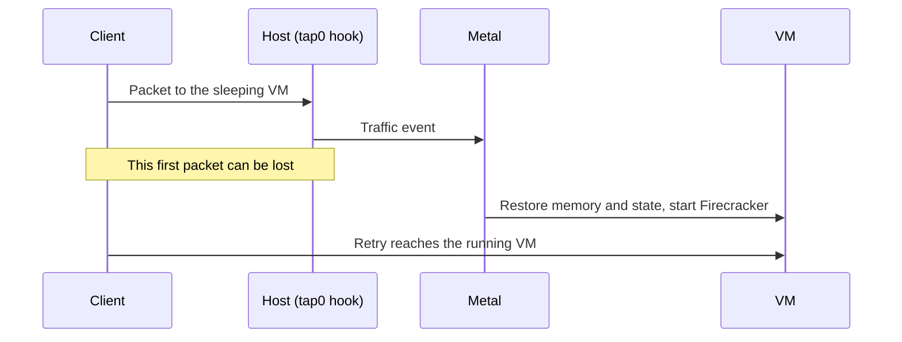

# Sleepy VMs

A **sleepy VM** is one that Metal saves and stops after an idle period. Metal restores it when new traffic arrives. While it sleeps, it uses no CPU or memory on the host, so a host can hold many more quiet VMs. It suits sites and VMs that are idle most of the day.

A VM is sleepy when `sleep_after_idle_seconds` is greater than `0`. Set it when you create the VM or with a resize. `0` turns sleeping off.

## How it sleeps and wakes

An explicit stop ends both states. Setting the timeout to `0` wakes a sleeping VM and turns sleeping off.

**Going to sleep:**

1. Metal watches traffic sent from the host to the VM.
2. Every 5 seconds, reconciliation checks running sleepy VMs with no pending change or error.
3. After the idle timeout, Metal saves memory and device state under `machines/<id>/saved-state/` and stops Firecracker.
4. Metal checks traffic again. If a packet arrived during the save, it restores the VM.

**Waking up.** An eBPF hook on the VM's `tap0` sees the next packet and tells Metal. Metal restores the saved state, and the VM carries on from where it stopped: open files and processes are intact.



Only real traffic counts: unicast IPv4 or IPv6 packets from the host to the VM, except ICMP. Traffic the VM sends, ICMP such as ping, ARP, and IPv6 multicast chatter do not keep it awake or wake it.

## What the state looks like

| Record | While sleeping |
| --- | --- |
| Desired state | `running`. Nobody asked the VM to stop. |
| Observed state | `stopped`. Firecracker is not running. |
| Sleep state | `sleeping`. See the values below. |
| Atlas list | Shows the last reported state, `stopped`. |

Metal reports the sleep state as `observed.sleep_state`. Atlas shows it as **Sleep State** on the VM. The sleep state tells where Metal keeps the saved state:

| Sleep state | Saved memory | Disk |
| --- | --- | --- |
| Empty | None. The VM is awake. | On the host |
| `sleeping` | On the host | On the host |
| `deep-sleeping` | In object storage | On the host |
| `comatose` | In object storage | In object storage |

Metal sets `deep-sleeping` after it uploads and removes local saved memory. It sets `comatose` after it also uploads and removes the local disk. A host with an older `metald` does not send the field, so Atlas shows the VM as awake.

The saved state belongs to one VM. It is not the shared [warm artifact](../storage/host-storage.md#snapshots-and-warm-artifacts) that speeds up a VM's first boot.

## Configure automatic offload

Atlas checks sleepy VMs every minute. It compares Metal's `observed.last_request_at` with **Deep Sleep After Idle (Seconds)** and **Coma After Idle (Seconds)** on each Virtual Machine. Both times start at the last request, not when the VM entered sleep. `0` disables that transition. Coma requires a shorter, nonzero deep-sleep threshold.

Set the delays in the create API request or with **Actions → Resize VM**. New VMs default both offload delays to `0`. Atlas stores these two values locally and does not include them in Metal compute or resize requests. An offload-only update does not contact Metal or wake the VM.

At the deep-sleep threshold, Atlas supplies signed memory upload and download URLs. At the coma threshold, it also supplies disk URLs. If both thresholds have passed, it requests both artifacts together. Atlas skips awake, draft, terminating, and migrating VMs. Missing request timestamps do not trigger an upload.

Upgrade the target Metal hosts and configure **Object Storage** in Atlas Settings before enabling offload. Atlas creates unique keys under `sleep/<site>/<vm>/<object-id>/memory` and `disk`. A key identifies one artifact and is not reused for a later checkpoint. Keep current checkpoint objects available while the VM depends on them.

The same job refreshes GET URLs for stored checkpoints once an hour, even when offload thresholds are disabled. Each artifact keeps its original object key after migration. Set the signed URL lifetime longer than one hour and allow time for queue delays and downloads.

Atlas caches each successful refresh per VM and checkpoint for one hour. Pending multipart completion bypasses this cache. A failed check appears in Error Log and retries on the next minute's schedule. The hidden `sleep_snapshot_objects` field retains object keys, upload IDs, and checkpoint ownership. It does not store signed URLs.

## Upload saved snapshots

Atlas can offload snapshots with `POST /v1/vms/{id}/sleep-state`. The VM must already be sleeping. Supply a multipart plan and a presigned GET URL for memory, disk, or both. Atlas uses the same part signing and object completion code as Machine images. Metal needs no object storage credentials.

Metal uploads memory parts first. Atlas completes the multipart upload and checks the exact compressed object size. It then acknowledges the upload through PATCH. Metal persists this acknowledgment before it removes local memory. Disk upload follows the same path after memory eviction. A failure keeps the artifact needed for recovery.

```json
{
  "memory": {
    "object_key": "sleep/site/vm/checkpoint/memory",
    "multipart": {
      "upload_id": "memory-upload-id",
      "part_size_mib": 64,
      "parts": [
        {"part_number": 1, "url": "https://objects.example/sleep/site/vm/checkpoint/memory?partNumber=1&uploadId=memory-upload-id&signature=..."}
      ]
    },
    "download_url": "https://objects.example/sleep/site/vm/checkpoint/memory?signature=..."
  },
  "disk": {
    "object_key": "sleep/site/vm/checkpoint/disk",
    "multipart": {
      "upload_id": "disk-upload-id",
      "part_size_mib": 64,
      "parts": [
        {"part_number": 1, "url": "https://objects.example/sleep/site/vm/checkpoint/disk?partNumber=1&uploadId=disk-upload-id&signature=..."}
      ]
    },
    "download_url": "https://objects.example/sleep/site/vm/checkpoint/disk?signature=..."
  }
}
```

The example shows one part per artifact. Include enough consecutive signed part URLs for the uncompressed size plus compression overhead. Part sizes range from 5 MiB through 5 GiB. Memory is a zstd-compressed tar archive of `state`, `memory`, and `metadata.json`. Disk uses the zstd-compressed raw image format. The SHA-256 digest covers uncompressed content, including the tar headers for memory.

Metal streams the memory archive into the image multipart compressor. It buffers at most two compressed parts on disk.

Metal keeps part ETags for retries and daemon restart. A new upload ID cannot reuse old ETags. A retry removes compressed part files left by a crash. Failed transfers retain immutable staging for retry; a wake or checkpoint replacement removes obsolete staging.

The request returns `202` and the VM response. Poll `observed.sleep_snapshot` for the checkpoint ID and artifact status. After part upload, each artifact reports `upload_id` and `pending`, which contains raw and compressed sizes, the digest, and part ETags. `uploaded` stays false until Atlas acknowledges object completion. A repeated request does not upload pending or acknowledged artifacts again. Signed URLs stay out of responses and logs.

`observed.phase` distinguishes preparation, compression, and HTTP upload. Progress counts compressed bytes read by HTTP and resets for each retry. Streaming compression learns the total compressed size at its end, so `upload_percent` can be absent while that total is unknown. Pending completion reports 99. Only an acknowledged object reports 100.

In Desk, open or refresh the VM form during an offload. The **Snapshot Upload** bar below **Sleep State** shows progress only while Metal uploads memory or disk over HTTP. Refresh the form to update the value. The field is hidden outside uploads, including preparation, compression, completion, and failure. Progress is not stored in Atlas.

Atlas uses `PATCH /v1/vms/{id}/sleep-state` to refresh GET URLs and acknowledge completed objects:

```json
{
  "snapshot_id": "<observed.sleep_snapshot.id>",
  "memory": {
    "completed_upload_id": "memory-upload-id",
    "download_url": "https://objects.example/sleep/site/vm/checkpoint/memory?signature=..."
  }
}
```

Omit `completed_upload_id` for a URL refresh alone. An omitted artifact keeps its GET URL. PATCH must name the stored checkpoint and keep each URL's scheme, host, and object path. An acknowledgment must match the artifact's pending upload ID. It enables local eviction but does not download artifacts or wake the VM.

Artifact status includes `object_key` when stored. Set it with the optional `object_key` field in an upload or URL refresh request. A nonempty key cannot change within a checkpoint. Atlas retains the original keys across migration.

Uploads use stable staging data, so a wake can proceed during upload. Upload completion does not evict data if the VM has already woken. The upload status belongs to its checkpoint ID. A request for a later sleep checkpoint creates a new ID.

Staging, compression, and uploads run in a separate pool of two background workers. Slow object storage does not consume normal VM reconciliation workers. The daemon cancels and waits for upload workers during shutdown. A later pass retries incomplete transfers after restart.

## Delete remote sleep snapshots

Atlas saves each object key and multipart upload ID before it sends the upload plan to Metal. After a new checkpoint replaces an old checkpoint, the sleep job aborts the retired uploads and deletes their objects. Migration preserves references instead of deleting the active checkpoint.

After a successful wake, Metal removes its sleep checkpoint record. When Atlas observes a running or paused VM with no sleep checkpoint, the sleep job deletes all retained objects. Cleanup continues even if idle sleep is disabled. A failed deletion retains its reference for the next attempt.

After Metal confirms VM termination, Atlas cleans all retained objects before it deletes the VM record. Cleanup runs before Frappe takes the document deletion lock. A failed abort or deletion keeps the reference and VM record for the next reconciliation attempt. Successful cleanup removes each reference separately. Use **Terminate** for a VM with retained objects; direct record deletion waits for cleanup.

VM saves preserve the transfer owner's current references from Frappe's locked previous record. A stale form cannot erase these references or replace them with another object's key. Retrying a completed multipart upload uses an exact-size HEAD check, so a lost acknowledgment does not publish the object twice.

Configure bucket lifecycle rules to abort abandoned multipart uploads. This catches a crash after object storage creates an upload but before Atlas receives and saves its ID. If bucket versioning is enabled, configure noncurrent-version expiration too: an ordinary object deletion leaves old versions in that bucket. Do not expire all objects under `sleep/` by age, because an active comatose VM can depend on them indefinitely.

## Wake an offloaded VM

Traffic and an explicit start use one restore path for all sleep states. For a comatose VM, Metal first recovers a missing disk. For either remote sleep state, it then recovers missing memory and calls the normal saved-state restore. It verifies artifact checksums and checkpoint metadata before use. A completed local download can be reused on retry.

Start returns `202` after it saves the wake request. Restores run in a separate pool of two background workers, independent of uploads and normal VM reconciliation. Poll the VM response for `observed.phase`, `observed.error`, and completion. A repeated pending start returns without waiting for the download. The daemon cancels and waits for restore workers at shutdown, and a saved wake request resumes after restart.

A download or artifact validation failure leaves the VM asleep and reports `observed.error`. Metal rearms traffic events after a failed wake and retries pending requests. If a GET URL expires, Atlas refreshes it with PATCH. PATCH stores URLs only. It does not create a wake request, but a pending wake uses the new URLs on retry.

If runtime restore fails after artifact preparation, Metal checks whether the guest already reached the requested state. If not, it removes the failed runtime and saved memory, then cold-boots the existing disk. This keeps the disk but loses processes and unsaved memory. A comatose VM must recover its disk first.

Cancellation and timeout errors retry without a cold boot. Metal logs the fallback and prevents later retries from loading the old remote memory. Cleanup and cold-boot failures report `observed.error`.

An explicit stop, restart, or shape change recovers an offloaded disk before it discards saved memory. [Migration](migration.md#move-an-offloaded-vm) moves an offloaded VM without waking it or downloading its snapshots.

## Automatic host rebalancing

Every minute, Atlas checks ready sleepy hosts, including hosts in maintenance. It adds the configured memory of running and paused VMs and compares the sum with host memory. It does not use guest RSS or discount the sum by the sleepy overcommit factor.

At 85% or more, Atlas selects sleepy VMs that are sleeping, deep-sleeping, or comatose. Above 90%, it also selects running sleepy VMs. Paused VMs count toward pressure but do not move automatically.

Running candidates rank by the fewest completed migrations in the last 24 hours, then largest memory, then VM name. Atlas selects enough running candidates to bring projected source pressure toward 85%. Sleeping candidates follow, largest memory first. There is no fixed VM-count cap.

Atlas submits a selected-only [Metal Server Drain](migration.md#drain-a-host) with four parallel migrations, memory snapshots enabled, and disk-only fallback disabled. Automatic drains leave the source maintenance flag unchanged. Manual drains keep their normal maintenance behavior.

Destinations must be emptier, ready sleepy hosts outside maintenance. Atlas checks projected destination memory, disk space, affinity, and memory compatibility through the existing placement and migration code. Planning counts the whole batch and existing incoming reservations. Placement rechecks capacity under its normal lock.

Host capacity and cached VM states must be at most two minutes old and match the current host. Metal confirms each candidate's sleep state. Draft, terminating, protected, service, and already migrating VMs are excluded. A host with a running drain gets no second drain.

Automatic drains recheck eligibility before starting migrations. A queued migration is aborted before placement if the VM wakes below the running-move threshold or the source no longer meets the policy. A drain can complete with selected VMs still on the source when they no longer qualify. Started migrations use the normal recovery path.

Follow automatic moves in Metal Server Drain and Virtual Machine Migration. The hidden `is_sleepy_rebalance` field identifies automatic drains. Pausing VM migrations also pauses new rebalance drains and migration starts.

Ordinary sleeping VMs resume on the destination. Deep-sleeping and comatose VMs stay asleep until a later wake. Moving sleepers reduces future wake demand, not the current running-memory sum.

## Placement

Sleepy VMs can live on their own hosts. With **Use Dedicated Sleepy VM Hosts** on in Atlas Settings, sleepy VMs go only to sleepy hosts, and regular VMs only to regular hosts. Auto-spawn creates a host for the right pool.

Because most sleepy VMs are asleep at any time, the `balanced` strategy divides sleepy memory by `sleepy_vm_overcommit_factor` when it ranks hosts. The capacity check still uses real free memory. `spread-3` and `best-fit` pack sleepy VMs onto the fullest sleepy host. See [placement](placement.md#strategies).

## Limits and recovery

- **The first packet can be lost** while the VM wakes. Clients must retry, as they would on any network.
- **Migration keeps the memory only with a memory snapshot.** A memory snapshot migration sends the saved state, and the VM resumes awake on the new host. A disk-only migration wakes the VM, shuts it down, and cold-boots it on the new host.
- **Some actions throw the saved state away:** an explicit stop, a restart, a shape change, or deleting the VM. The next start is a normal boot.
- **A failed runtime restore can lose memory.** See [wake recovery](#wake-an-offloaded-vm) for cold-boot fallback and retry behavior.
- A `metald` restart resets the idle clock, so a VM can sleep later than expected, never earlier.
- A start resets the idle clock, so a VM is never put to sleep before the guest has booted.

To check a sleepy VM, see [Automatic idle shutdown](../operate/metal.md#automatic-idle-shutdown-does-not-stop-or-restore-a-vm) in the Metal runbook.

::: details Source code and tests

- [Idle watcher](../../metal/internal/vm/idle_watcher.go) decides when to save and when to restore.
- [Traffic monitor](../../metal/internal/network/traffic/monitor.go) and [eBPF program](../../metal/internal/network/traffic/bpf/track_traffic.c) record host-to-guest traffic.
- [Firecracker machine](../../metal/internal/firecracker/machine.go) saves and restores the VM state.
- [Placement strategies](../../atlas/vm/core/placement/strategies/balanced.py) apply the sleepy pools and overcommit factor.

:::
