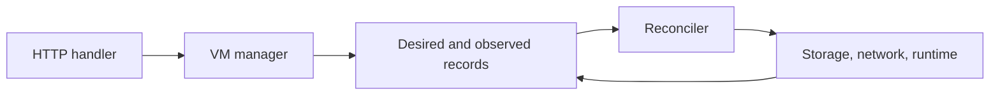

# Work on Metal

::: warning Local setup is a work in progress
The host setup and integration steps are not fully verified. Use a disposable host and ask the team if a step fails.
:::

Metal is the Go daemon on each physical host. Atlas decides where a VM belongs and sends the requested state. Metal saves that request, applies it with Firecracker, systemd, ZFS, and Linux networking, then reports what happened. Start with [how a VM request works](../start/how-a-vm-request-works.md) if this boundary is new.

## Trace one VM request



The HTTP handler checks and passes the request to the VM manager. The manager writes the desired record before Metal returns success. The reconciler then applies host work and updates the observed record. A reply can arrive before the VM is ready. [Reconciliation](../compute/reconciliation.md) explains generations, retries, and failures.

For a VM change, start in `internal/api`, then follow `internal/vm` into the package that owns the host resource. `cmd/metald` connects those packages at startup. It should not contain VM policy.

## Find the package that owns your change

| If you change... | Start here | Read |
| --- | --- | --- |
| A route or request field | `internal/api` | [Atlas to Metal rules](../interfaces/metal-contract.md), [API reference](/api/metal/) |
| VM records, generations, or cleanup | `internal/vm`, `internal/reconciler` | [Reconciliation](../compute/reconciliation.md) |
| Boot, stop, console, or Firecracker | `internal/firecracker`, `internal/console`, `internal/platform` | [Runtime](../compute/runtime.md), [console](../compute/console.md) |
| Disks, images, or snapshots | `internal/storage` | [Host storage](../storage/host-storage.md), [host layout](../storage/host-layout.md) |
| Namespaces, routes, firewall, or mesh | `internal/network` | [Host networking](../networking/host-networking.md) |
| Host inventory or capacity | `internal/host` | [Host sync](../region/host-sync.md) |
| Moving a running VM | `internal/vm/migration` | [Host migration steps](../compute/migration-engine.md) |
| Listeners, config, or worker lifetime | `cmd/metald` | [Daemon and API](../region/metald.md) |

Each package has a nearby `SPEC.md` with its code contract. The [Metal specification](../../metal/SPEC.md) has the import map. The [code map](code-map.md) links to entry files and tests.

::: info Keep the ownership boundary clear
The API handles transport, the VM manager owns requested and observed state, and host packages own their resources. Put a rule where its owner can enforce it on every retry.
:::

## Build and check a change

Run Go commands from `metal/`. The eBPF object must exist before a direct Go test because the traffic package embeds it.

```sh
cd metal
make bpf
make test
make vet
go test -race ./...
make build
```

Use `gofmt -w <changed-go-files>` after editing Go files. `make build` regenerates Swagger and builds Linux binaries. `make openapi` generates only Swagger, which Git ignores. eBPF needs Clang 12 or newer and Linux/libbpf headers. TCX traffic monitoring needs Linux 6.6 or newer.

Unit tests can run without a VM host. Boot, network, and firewall checks need host features. The [Metal host test guide](metal-testing.md) has the setup and commands. It is still a work in progress.

## Change stored state with a patch

metald keeps records and other state under `base_dir`, which is `/var/lib/metal` by default. A new build must read the state that an older build left. When a change makes old state unreadable, such as a renamed record field, add a patch in `internal/patches`.

At startup, before it reads any state, metald runs each patch that `base_dir/patches.json` does not list yet. It runs them in list order and adds each name to the file after the patch succeeds. A failed patch stops startup, and the error names the patch.

### Add a patch

1. Choose one name that says what the patch changes, such as `rename_status_keys_to_snake_case`. Use it for the patch name, the file, and the function.
2. Write the function in `internal/patches/<name>.go`. It gets the base directory and changes the files under it.
3. Add the patch at the end of `All` in `internal/patches/patches.go`.
4. Add a test that writes the old state, runs the patch, and checks that metald reads the result with every value.

```go
// rename_status_keys_to_snake_case.go
func renameStatusKeysToSnakeCase(baseDirectory string) error {
	paths, err := filepath.Glob(filepath.Join(baseDirectory, "machines", "*", "status.json"))
	// For each file: read it, rename the old keys that are still present, and write it with platform.WriteFile.
}
```

```go
// patches.go
var All = []Patch{
	{Name: "rename_status_keys_to_snake_case", Apply: renameStatusKeysToSnakeCase},
}
```

### Keep a patch idempotent

**Mandatory: a patch must be idempotent.** metald can stop after a patch changes the state and before it lists the patch, so the next start runs the patch again. A second run must leave the same state as the first run, without an error.

- Change only what is still in the old form. For example, rename a key only if the old key exists.
- Write each file with `platform.WriteFile`, which replaces the file in one step. A crash then leaves the old file or the new file, never part of one.
- Do not depend on state that the patch removes. Read what you need before you delete or replace it.
- Test it: run the patch twice on the same state, and check that the result does not change.

### Rules

- Never change or remove a released patch. A host that skips builds runs every patch that it has not run yet.
- Patches only move forward. An older `metald` cannot read state that a newer patch changed, so fix a bad change with a new patch.

## Check host behavior when it matters

Test both first boot from a fresh clone and later boot from an existing disk. Shared warm memory is valid only for the first case. If your change touches lifecycle or console handling, also test explicit stop, daemon restart with console adoption, and idle save and restore.

Use a disposable host for integration work. The development script changes networking and creates a ZFS pool, systemd unit, guest image, and TLS credentials. Its file-backed pool is a development aid, not a host provisioning design.

::: details Source code and tests

- [Metal entry point](../../metal/cmd/metald/main.go) creates services and listeners.
- [VM manager](../../metal/internal/vm/manager.go) owns accepted VM changes.
- [VM reconciler](../../metal/internal/reconciler/virtual_machines.go) schedules host work.
- [Metal Makefile](../../metal/Makefile) defines generation and checks.
- [Host test guide](metal-testing.md) names integration requirements and commands.

:::
