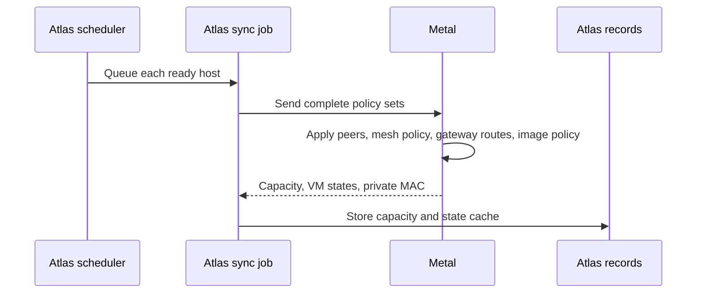

# Host sync and recovery

Host sync sends regional policy to Metal and returns host capacity and VM state to Atlas. Metal's own reconciler keeps VMs running between syncs.

## What a sync exchanges

The scheduler selects Metal Servers that are `Running` with completed setup.

| Direction | Data |
| --- | --- |
| Atlas → Metal | Complete WireGuard peer set, privileged VM addresses, WireGuard gateway return routes, image cache policy, and transport mode. |
| Metal → Atlas | Capacity, VM states, private interface MAC address, and optional host compatibility facts. |

Metal replaces its managed policy sets and wakes the relevant reconcilers. Atlas stores a capacity sample and updates its VM state cache. A new or changed VM state is saved as a document and sends the state webhook. An unchanged state only gets a new sync time, in one update for the host.

When Metal starts, the Firecracker runtime captures architecture, configured CPU profile, CPU vendor/model/features, and x86 clock frequency and scaling support. Its runtime fingerprint hashes Firecracker binary contents, architecture, and the host kernel release.

It sends the same facts in each sync without running the probes again. Provisioning, host reboot, and daemon restart refresh these facts.

A failed startup probe is logged once and leaves the optional report absent until Metal restarts. Capacity and VM-state sync continue.

Atlas stores the validated JSON in Metal Server's `host_compatibility_report` and exposes `tsc_scaling_supported` as a read-only checkbox.

The next host sync populates these fields after an upgrade. Sync updates them only when the report changes and leaves the server's edit timestamp unchanged. A document save preserves the latest synced facts from the locked server row.

Reports have no expiry. A host that omits the optional report clears its stored facts. Only memory snapshot migrations require the report; they do not probe hosts. Placement still requires recent capacity. See [migration checks](../compute/migration.md#compatibility-before-transfer).

### Why sync sends complete sets

A complete set repairs policy after a restart or missed sync. Atlas includes a peer only after it has keys, network addresses, and a private interface MAC.

The Atlas `Virtual Machine State` record remains a **cache**. Its `server` field is the host that sent the last report, so it follows the VM after a migration. Read Metal when you need current guest state.

## Failure and recovery

| Failure | Result |
| --- | --- |
| Invalid or failed sync | Atlas writes no new capacity sample. It logs the first failure, then at most once an hour until the host syncs again. |
| Compatibility probe or report fails | Capacity and VM-state sync continue. Compatibility facts are cleared; new memory snapshot migrations are blocked. Disk-only migrations can proceed. |
| Sample older than 2 minutes | Placement excludes the host and does not queue a new host. |
| A host runs a VM that has no Atlas record | Atlas logs the VM IDs in Error Log, at most once an hour for each host. |
| metald cannot read a VM's records | The VM is left out of the states and listed in `invalid_virtual_machines`. The host reports no free capacity, and Atlas logs the VM IDs at most once an hour. |
| Policy partly applied | The next full sync can apply it again. |
| Atlas unavailable | Metal continues VM, image, and migration reconciliation. |
| Metal restarts | It reads its saved records. Guests survive only if systemd preserved their console descriptors. |

Check the latest `Metal Server Usage` timestamp, Atlas Error Log, Metal journal, and VM record.

**Details:** [Placement](../compute/placement.md), [Metal operations](../operate/metal.md), and the [Metal sync API](/api/metal/).

::: details Source code and tests

- [Atlas scheduler](../../atlas/hooks.py) queues periodic sync.
- [Atlas sync job](../../atlas/metal_server/usage.py) builds policy sets and stores reported state.
- [State cache](../../atlas/vm/core/vm_state.py) stores last-reported VM states.
- [Metal host service](../../metal/internal/host/service.go) applies complete sets and reports capacity.
- [Metal startup](../../metal/cmd/metald/main.go) restores host services and consoles.
- [Atlas state tests](../../atlas/vm/core/test_vm_state.py) and [Metal host tests](../../metal/internal/host/service_test.go) check the contracts.

:::
