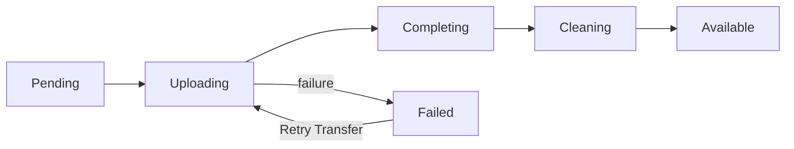

# VM images and artifact storage

Atlas owns image records and artifacts. Metal caches the artifacts on hosts and creates VM disks. See the [transfer flow](index.md) for the sequence.

| Image type | Access |
| --- | --- |
| System | Shared with every tenant. |
| Machine | Owned by the source VM's tenant. |

An image records its root filesystem, architecture, sizes, and SHA-256 digests, and links one kernel record. **Only an enabled, Available image can create a VM.**

## Kernels

A `Virtual Machine Kernel` record stores one kernel under its SHA-256 value. Every image with that kernel links the same record, so Atlas stores and uploads each kernel once. Atlas deletes a kernel record and its stored file when no image links to it.

## System images

The Ubuntu builder publishes a kernel and root filesystem as a new Available System image. Each build gets a new record and its own rootfs path. A build with an unchanged kernel reuses its kernel record.

Each Ubuntu image build uses the latest Ubuntu cloud image release and the newest kernel that Ubuntu supports for that release: the HWE (hardware enablement) kernel for 22.04 and 24.04, and the generic kernel for 26.04. The rescue image uses the 24.04 steps. The build log shows the download URLs.

The builder checks earlier Available images with the same title, architecture, and purpose tag. If one has the same digests, the build changes nothing.

After base image publication, the builder retires the earlier base images. Rescue builds keep earlier images. See [rescue mode](../compute/rescue.md).

Atlas protects each new System image from termination. The base image builder removes this protection from earlier base images before it retires them.

::: info Guest disk errors
New Ubuntu System images set ext4 to remount the root filesystem read-only when it detects an error. This stops further writes to a damaged filesystem.

The remount does not repair the disk. See the [guest disk incident](../incidents/2026-09-24-guest-disk-corruption.md) for the reason behind this setting.
:::

## OCI images

`POST /images/import` builds a Machine image of the calling tenant from a public OCI image, such as `nginx:1.29-alpine`. Tenant 0 can set `image_type` to `system`. The command `bench --site <site> import-oci-image <reference> [--tenant-id 0] [--image-type system]` does the same for an operator. Only the registries in `ALLOWED_REGISTRIES` are allowed.

```text
Atlas                               Builder VM (tenant 99999)
  pin the reference to its digest
  image status: Building
  create the VM with user data  -->  download oci-rootfs
                                     pull, unpack, write ext4
  read the result every 30 s    <--  upload the zstd copy and the result
  image status: Available or Failed
  terminate the VM
```

The builder VM holds signed URLs only. A build that does not finish in 1 hour fails. A second request for the same digest and `oci-rootfs` version returns the first image. A tenant can run 2 builds at a time.

The ext4 file is only as large as the image needs, and the guest grows it to the VM disk at boot.

`guest-init` is PID 1 of the VM. It does the work of systemd, cloud-init, and sshd, so the image needs none of them:

| Job | Behavior |
| --- | --- |
| Network | Reads the kernel `ip=` argument, then applies the mesh address and routes from metadata. |
| Entrypoint | Runs the image entrypoint. A clean exit keeps the VM up. A failed exit stops its process group and restarts it, with a delay of up to 1 minute. |
| Stop | Sends the image stop signal, waits up to 15 seconds, and then ends the other processes. |
| Consoles | Serves SSH and SFTP with keys from metadata, and a root shell on the serial console. An image with no shell has no consoles. |
| Disk | Grows ext4 at boot and after a disk resize. |

Set these keys in the VM metadata:

| Key | Effect |
| --- | --- |
| `env.<NAME>` | Sets a variable for the entrypoint and the consoles. The entrypoint reads it when it starts. |
| `command` | A JSON array that replaces the image command. |
| `ports` | Forwards guest ports to programs on `127.0.0.1`, such as `80:8080/tcp,53:5353/udp`. The protocol is `tcp` by default. A port cannot forward to itself. A change applies within 2 seconds. A removed TCP forward keeps its open connections, and a removed UDP forward stops at once. The program sees `127.0.0.1` as the client address. |

## Artifact storage

The `artifact_storage` field selects the artifact location:

| Value | Location | Download URL |
| --- | --- | --- |
| `Object Storage` | Atlas Settings bucket: the rootfs under `images/<image ID>/`, the kernel under `kernels/<SHA-256>` | Signed. Valid for 24 hours. |
| `Site File` | Public site File under `/files/` | Public. No expiry. |

### Bootstrap without object storage

Build the first System image with `--storage site-file`. Set `atlas_internal_url` to an address the host can reach.

Site Files are public, so only System images can use them. The tenant download route refuses Site File images.

### Move artifacts to object storage

Saving object-storage settings queues migration of Available Site File images. A job checks again every **15 minutes**, including images whose earlier migration failed.

Use **Migrate to Object Storage** to start one migration immediately.

For each image, the job:

1. Uploads the rootfs under a key owned by the image, and the kernel under `kernels/<SHA-256>` when it is not in object storage yet. It compares sizes.
2. Saves the keys and changes `artifact_storage`.
3. Keeps the site Files for six hours so hosts can finish earlier downloads, then deletes them.

Hosts have a downloadable copy at each step. The `immutable_reference` uses architecture and digests, so hosts keep their existing cache.

## Machine images

Select **Create Machine Image** to stage the VM disk on Metal. Metal's UUIDv7 snapshot ID becomes the image record name. The image links the kernel of its source VM, so Metal uploads only the disk.

Atlas saves multipart upload IDs before it starts the transfer. It checks hashes and sizes before publication.

If a transfer fails, Atlas keeps the source host, snapshot ID, object keys, and upload IDs. **Retry Transfer** uses the same image record and upload IDs.

Atlas does not write signed URLs to logs.

## Listing

- `GET /api/atlas/images`: enabled tenant images and enabled System images. Filter with `image_type=system` or `image_type=machine`.
- `GET /api/atlas/images/<image ID>`: also returns disabled images so clients can follow retirement.

## Image status



The diagram shows a Machine image transfer and its retry path. A transfer can also fail before upload or during completion.

A timeout or a `5xx` answer from the source host does not fail the transfer. Atlas shows the error on the image, keeps its status, and the pending-transfer job tries again.

Retirement changes an Available or Failed image to `Archived`.

## Retirement and deletion

Retire an Available or Failed image to stop new use immediately. Retiring an image that is already `Deleting` or `Archived` changes nothing.

Termination protection blocks retirement for both System and Machine images.

Atlas keeps a retired image's objects or public site files for six hours. This gives hosts time to finish downloads that started before retirement.

A migrated image also keeps its old site files until the separate migration deadline ends.

The image stays `Archived` with its rootfs and kernel while any VM record names it. A host can prune its cached copy, so a VM that starts, restarts, or migrates must still be able to download the image.

After the deadline and the last VM record, Atlas changes the image to `Deleting`, deletes the remote rootfs and Metal staging, and removes the record.

Atlas records a cleanup failure and retries every **30 seconds**.

## Cached and warm artifacts

Host sync requests caching for enabled Available images with `cache_image`.

A warm artifact contains disk, memory, and Firecracker state for one image and VM shape. It stays on its host.

If a shared warm artifact cannot be used, the VM starts without it.

## Limits and recovery

Check artifact URL access and free host storage before you retry a transfer.

See [Metal storage](host-storage.md) for local staging and cleanup. See the [Atlas API](/api/atlas/) for image operations.

::: details Source code and tests

- [Image DocType](../../atlas/vm/doctype/virtual_machine_image/virtual_machine_image.py) owns image metadata and visibility.
- [System image builder](../../atlas/vm/core/image_builder.py) publishes base and rescue artifacts with separate purpose tags.
- [Rescue image recipe](../../atlas/vm/scripts/build_ubuntu_rescue_image.sh) builds the independent repair image. See [rescue operation](../compute/rescue.md).
- [Ubuntu image script](../../atlas/vm/scripts/build_ubuntu_server_image.sh) builds the guest root filesystem and sets its error behavior.
- [Machine image transfer](../../atlas/vm/core/vm_image_transfer.py) owns snapshot progress.
- [Storage migration](../../atlas/vm/core/vm_image_storage_migration.py) moves bootstrap files to object storage.
- [Image deletion](../../atlas/vm/core/vm_image_deletion.py) retires and reclaims artifacts.
- [Object storage client](../../atlas/atlas/object_storage.py) owns signed URLs and object operations.

:::
