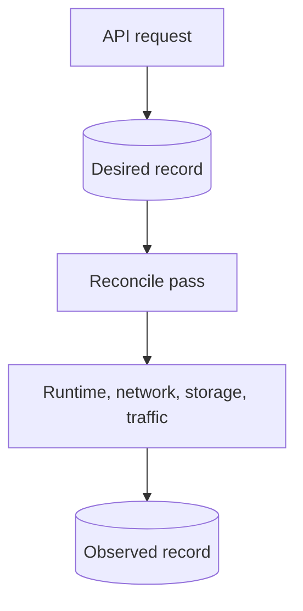

# vm: virtual machine manager

For Go code, follow the repository [Go anti-pattern rules](../../../llm/go-code-review-guide.md).

[Metal specification](../../SPEC.md) · overview: [Metal reconciliation](../../../docs/compute/reconciliation.md)

## Purpose

This package owns VM records, state transitions, and reconciliation. Host packages implement runtime, network, storage, and snapshot operations through small interfaces declared here.

## Request flow



- The desired generation rises only for a real desired change.
- The restart generation rises for each accepted restart.

## Records

```text
machines/<id>/config.json   desired state and specification
machines/<id>/status.json   observed state and operation progress
machines/<id>/metrics/     seven days of daily VM usage files
```

- The create fingerprint excludes signed image URLs.
- A firewall change increases the specification generation.
- `cpu_millicores` accepts 100 through 32000. Firecracker receives `ceil(cpu_millicores / 1000)` vCPUs.
- A `sleep_after_idle_seconds` change does not change `SpecificationGeneration`.
- The daemon validates every record at startup. It does not repair or remove an invalid record.
- A record format change ships a patch in `internal/patches`. See [Change stored state with a patch](../../../docs/develop/metal.md#change-stored-state-with-a-patch).

## Reconciliation

| Desired power state | Action |
| --- | --- |
| `running` | Start, resume, or restore. Stop after idle when configured. |
| `paused` | Start or restore, then pause. |
| `stopped` | Hard stop and delete saved state. |
| `destroyed` | Remove runtime, network, storage, and records. |

Idle behavior is in [Sleepy VMs](../../../docs/compute/sleepy-vms.md).

`sleep_state.go` owns `machines/<id>/sleep-state.json`, a mode `0600` record for one upload checkpoint and its artifact URLs. `sleep_transfer.go` uploads artifacts through a separate two-worker reconciler and evicts local data only for the matching sleeping checkpoint. It persists the remote sleep state before eviction.

A per-VM transfer lock serializes uploads. The operation lock protects staging and status updates, and is released while upload bytes move. Wake holds the operation lock through download and restore. Reconciliation skips a busy VM instead of waiting for its lock. `restoreSavedState` prepares remote artifacts for both deep sleep and comatose states before runtime restore. See [offloaded wake](../../../docs/compute/sleepy-vms.md#wake-an-offloaded-vm).

`OffloadSleepArtifacts` runs under the daemon-owned upload pool. `RestoreSleepState` reconciles sleeping VMs in a separate two-worker pool. Normal VM reconciliation does not wait for either pool. Sleep reconciliation preserves upload phases while the checkpoint still matches. A stop, restart, shape change, or destruction can proceed without acquiring the transfer lock. A late upload failure cannot replace a wake or stop result.

Upload completion cannot evict artifacts after migration takes the VM's source lock.

Start and traffic requests increase the desired generation for a sleeping VM. A pending generation prevents further offload and tells reconciliation to restore instead of rearming sleep. The request survives daemon restart. Duplicate pending starts do not wait for the restore lock or add another generation.

The existing VM response adds optional `upload_percent` to each artifact under `observed.sleep_snapshot.memory` and `.disk`. It is absent before HTTP upload and after a failed transfer ends. Active uploads report 0 through 99 from compressed bytes read by HTTP. Only an acknowledged artifact reports 100.

`SleepUploadProgress` counters belong to the active transfer, reset on each retry, and are never written to records. `observed.phase` distinguishes `prepare-sleep-memory`, `compress-sleep-memory`, and `upload-sleep-memory`, with matching disk phases. Live progress does not replace a wake operation's phase.

[Sleep-state tests](sleep_state_test.go) check partial selection, eviction retries, a wake during upload, request-triggered wake, and URL refresh after a failed download.

- A valid saved state is authoritative when Firecracker is stopped.
- A saved state beside a running Firecracker process is stale and is deleted.
- Wake restore failures reuse `recoverFailedRestore` in `migration_state.go`. `sleep_restore_test.go` checks fallback, cancellation, missing disks, and retries after daemon restart. See [wake recovery](../../../docs/compute/sleepy-vms.md#wake-an-offloaded-vm).
- A restart or machine shape change deletes the saved state.
- Traffic restore takes the per-VM lock. A stale or duplicate event has no effect.
- The phase and operation ID are written before each host call.
- Destroy records progress per resource, so an interrupted destroy resumes.

## Migration

The migration lifecycle lives in [internal/vm/migration/SPEC.md](migration/SPEC.md). This package does not import that package.

- The daemon injects a `MigrationGuard` with `SetMigrationGuard`.
- Without a guard, no VM is migrating.
- `migration_sleep.go` exposes `SleepMigration` and captures and applies an acknowledged checkpoint without runtime calls. `SleepCheckpoint.SourceUserID` supplies the original identity for installation on a later wake.

## Boundaries

- Host packages implement `Runtime`, `Network`, `Storage`, and `Snapshots`.
- `RuntimeUsage` carries a runtime's CPU time, memory, and disk I/O to the VM metrics sampler.
- The daemon traffic listener passes each `traffic.Event` to `Manager.RestoreAfterTraffic`, then wakes the restore reconciler.
- `WarmImageBuilder` creates shared start artifacts. It does not use the saved state of an idle VM.

## Related

- [internal/firecracker/SPEC.md](../firecracker/SPEC.md) implements `Runtime`.
- [internal/storage/SPEC.md](../storage/SPEC.md) implements `Storage` and `Snapshots`.
- [internal/network/SPEC.md](../network/SPEC.md) implements `Network` and owns packet tracking.
- [internal/reconciler/SPEC.md](../reconciler/SPEC.md) drives reconciliation.
